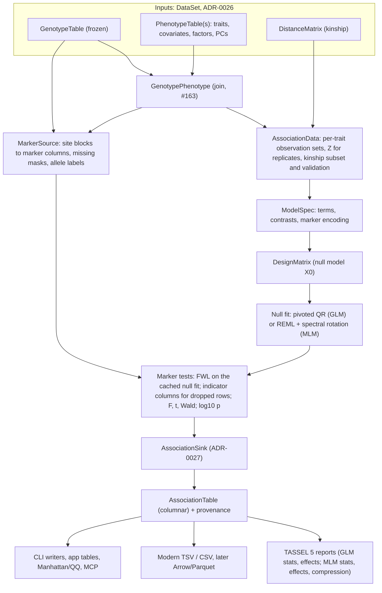
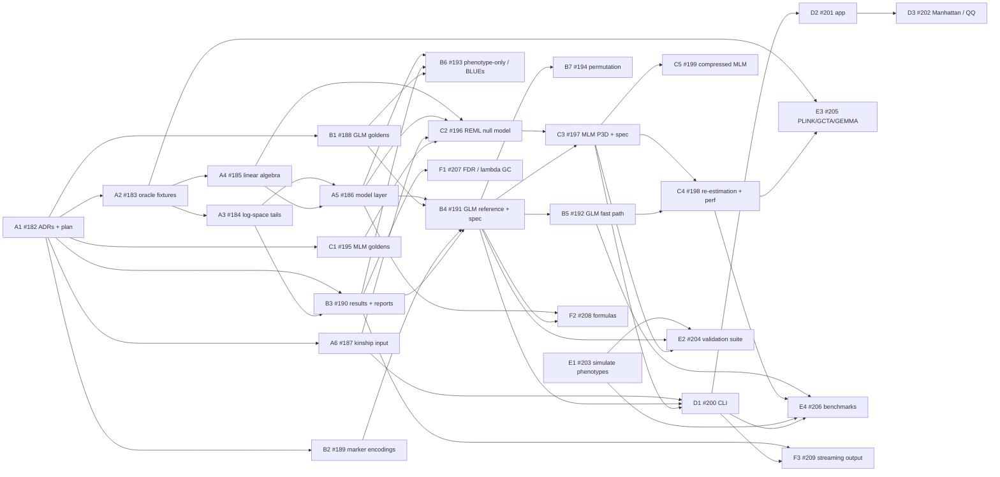

# Association mapping (GLM and MLM): audit, architecture, and phased plan

Epic [#181](https://github.com/maize-genetics/tassel-6/issues/181) ("Association mapping: GLM and MLM on a shared statistical modeling
layer"). Written 2026-11-25, after `6.0.0-alpha.2`. The epic's sub-issues (#182–#209) are the live
task list and hold each task's full text; ADR-0025 to ADR-0029 hold the decisions. The letter IDs
below (A1, B4, …) map to issue numbers in section 5.

## Context

Roadmap Phase 2 (`docs/llm_notes/TASSEL_6_KMP_ROADMAP.md`, "Phase 2: teaching MVP") lists "GLM,
MLM (EMMA/P3D with compression), LD with a heatmap, Manhattan and QQ plots". Epic #155 built the
foundations: typed phenotypes, TASSEL formats, joins, genotype-phenotype alignment, and the F, t,
and chi-square distributions. This epic adds association mapping on top of them.

The brief asks for a modern, extensible framework, not a transliteration of TASSEL 5's plugin
classes: port statistical behavior, keep TASSEL 5-compatible outputs, fix legacy limitations
deliberately, and design for later methods (logistic, stepwise, LOCO, FarmCPU/BLINK, genomic
prediction) without building them now.

**Proposed decisions for the maintainer** (each is an ADR in `Proposed` state; see the table at
the end for the open questions):

- ADR-0025: one decomposition-based modeling layer in `commonMain` (pivoted QR, Cholesky,
  existing eigensolver; no explicit inverse; FWL reuse; log-space p-values).
- ADR-0026: `DataSet` inputs, alignment by taxon name, per-trait and per-marker missingness, no
  silent imputation, replicates, kinship reader and validation, and marker encodings behind a
  `MarkerSource` seam (`GenotypeTable` stays frozen).
- ADR-0027: columnar `AssociationTable` results through an `AssociationSink`, TASSEL 5-compatible
  reports kept byte-for-byte in layout, modern TSV with log p and alleles, and provenance.
- ADR-0028: REML by EMMA-style spectral search, P3D as default, per-marker re-estimation as an
  option, kinship scaling and heritability definitions, and failure semantics (never fall back to
  GLM).
- ADR-0029: parity and validation policy: TASSEL 5 goldens, a new `testdata/oracle/` tree for
  independent references (R, NIST StRD, mpmath, PLINK 2, GCTA, GEMMA), per-column tolerances, and
  a departure procedure.

## 1. Audit of TASSEL 6 (develop at `30c631f`)

`T6` = `tassel-core/src/commonMain/kotlin/net/maizegenetics/tassel`.

### Repository state

- `main` is at the `6.0.0-alpha.2` release merge (`a3558fc`). `develop` (`30c631f`) does not yet
  have the release commit's `CHANGELOG.md`, `README.md`, and `gradle.properties` changes, so the
  main-to-develop back-merge looks pending. This plan branches from `develop`, per AGENTS.md.
- ADR-0022, ADR-0023, and ADR-0024 are still `Proposed` in `docs/adr/README.md` although the work
  they govern has merged. Marking them `Accepted` is maintainer housekeeping, and this epic builds
  on all three.
- The `agent-task` issue template's default "Done when" names `macosArm64Test`, which AGENTS.md
  makes advisory. Epic #155's issues used `linuxX64Test`; these drafts do the same.

### What association mapping can reuse

| Area | TASSEL 6 today | Use in this epic |
|---|---|---|
| Genotypes | `genotype.GenotypeTable` (frozen, ADR-0012): diploid nucleotide bytes, `siteBlocks(blockSize = 4096, taxa = IntArray?)`, `SiteBlock.copySiteGenotypes`, `siteStats`. `AlleleStats`: alleles sorted by count (ties by code), gamete counts, MAF, het counts, partly-unknown counts | Marker loop reads site blocks over `GenotypePhenotype.genotypeTaxonIndices()`. `AlleleStats` gives major and minor alleles for coding. No full taxa x sites matrix |
| Allele identity | Nucleotide codes (`Allele`, `Genotype`) and `Position.knownVariants`; reference/alternate and INFO were retired (ledger, #14) | Effect alleles are named by code and `knownVariants`; there is no reference allele, so "effect allele = minor allele among analysis observations" is the default (ADR-0026) |
| Phenotypes | `phenotype.PhenotypeTable` (ADR-0023): `Float` storage read as `Double`, NaN the only missing number, factor code -1, sorted levels, `AttributeType` `data`/`covariate`/`factor`/`taxa`, `hasReplicatedTaxa`, distinct `taxa` | Traits are `data`, fixed effects are `covariate` and `factor`, exactly TASSEL 5's roles |
| Alignment | `join.GenotypePhenotype(genotypes, phenotype, genotypeRow)`, `alignGenotypePhenotype` (intersect or union), `join-genotype-phenotype` spec; `dataset.DataSet` with `phenotypes()` and `genotypes()` | GLM and MLM take a `DataSet` (ADR-0026). Genotypes are never copied; replicates share a genotype row |
| PCA | `analysis.PrincipalComponentsResult.principalComponents` is a `PhenotypeTable` of `covariate` columns `PC1..PCk` (`Float`) | Join it as covariates with `join-phenotypes`; no new code. Name collisions follow ADR-0024 |
| Kinship | `distance.DistanceMatrix` (`Float` lower triangle, annotations, TASSEL square-matrix writer). `kinship` spec: Centered IBS only, blocked dosage product (ADR-0020) | Kinship input for MLM. **No production reader** (only the test-side `SquareMatrix.parse` in `commonTest/.../testing/GoldenCompare.kt`), no subset-by-taxa, no validation |
| Linear algebra | `math.SymmetricEigenDecomposition`: JAMA `tred2`/`tql2`, lower triangle input, eigenvalues descending, deterministic sign. About 1.3–1.5 s at 1,000 x 1,000 on the JVM (`docs/poc/benchmarks.md`), no progress reports inside | EMMA spectral decomposition. Needs a progress or yield hook for thousands of taxa in the browser. **No matrix type, QR, Cholesky, or solver** |
| Statistics | `stats.SpecialFunctions` (Cephes via Colt), `fTestPValue` (TASSEL 5 `LinearModelUtils.Ftest` semantics), `FDistribution`, `StudentTDistribution`, `ChiSquaredDistribution` (`pdf`, `logPdf`, `cdf`, `sf`, `quantile`, `inverseSf`) | Every p-value. **No `logSf`**, so `log10 p` is lost once `p` underflows |
| Tables | `table.ResultTable` (boxed `List<List<Any?>>`), `DoubleFormat` (TASSEL 5 report formatting), `floatToString`/`doubleToString` | `DoubleFormat` formats the legacy reports. `ResultTable` is too heavy for GWAS-scale output (ADR-0027) |
| Operations | DSL types `int`, `double`, `boolean`, `enum`, `file(FileKind)`, `string`, `stringList`; `legacy` names; 10 registered ops; `OperationDescriptor.inputType` `"DataSet"` means multi-select | `glm` and `mlm` specs fit the DSL as is: traits, covariates, and factors are `stringList`s; encodings are enums |
| Progress and cancellation | `ProgressReporter.report` suspends (ADR-0019); `LocalEngine` checks cancellation and yields at each report; wasm app yields to the event loop | Report per site block and inside long decompositions |
| Parallelism | `expect fun kinshipWorkerCount()` (JVM processors, native `sysconf`, wasm 1); `internal var kinshipTriangleUpdate` hook with `PureKotlinSyrk`; results independent of worker count (ADR-0020) | Same pattern for marker-parallel GLM/MLM and for a later BLAS/GPU kernel hook |
| Acceleration spikes | JVM Vector API and native OpenBLAS kinship fast paths: no-go (`docs/poc/kinship-*-fast-path.md`). WebGPU Gram spike: dosage products bit-exact, dense f32 Gram loses to Accelerate/OpenBLAS `ssyrk`, stage 2 (bit-plane popcount) is the next spike; its ADR was never written and the number it cites (0022) is now BCF's (`docs/poc/gpu-gram-spike.md`). Wasm workers: "go later" | Pure-Kotlin reference first; GPU and BLAS are later phases with their own ADR |
| Goldens | `scripts/generate-goldens.sh` (TASSEL 5 `v5.2.98` standalone, `-maxThreads 4`, JDK 21+), `.full.txt` twins via the `DoubleFormat.java` shadow, `Distributions.java` harness, MANIFEST tolerances `exact`, `abs`, `rel`, `format`, `phenotype`, `up-to-sign`, `rows-unordered`; test helpers `TestData`, `GoldenManifest`, `assertMatchesGolden` on every target | GLM/MLM goldens reuse all of it. The full-precision twin is what makes GLM statistics comparable at `rel 1e-8` |
| Test data | `testdata/tutorial/` has `mdp_genotype.hmp.txt`, `mdp_traits.txt`, `mdp_population_structure.txt`; `golden/kinship/centered_ibs.txt` is TASSEL 5's kinship of the tutorial genotypes | **`mdp_kinship.txt` (the TASSEL 5 MLM tutorial kinship) is not in the repo or the golden inputs** |
| CLI | Subcommands generated from specs; repeatable `--input` for `DataSet`; content sniffing for phenotype tags; `outputParts` writes one file per result part | Needs kinship sniffing (a matrix file is classified as genotypes today) and an `outputParts` branch for association results. `OperationCommand` rejects input types other than `Unit`, `GenotypeTable`, `PhenotypeTable`, `DataSet` |
| App | Operations offered by `inputType`; two or more selections offer `DataSet` operations; `Chart` is `Heatmap` or `Scatter` (custom Canvas, no chart library); progress banner with Cancel | A `DistanceMatrix` or `GenotypePhenotype` result is a result node, not a selectable dataset, so MLM cannot be fed in the app yet. No Manhattan or QQ chart |
| Benchmarks | `scripts/bench/run-benchmarks.sh` (TASSEL 5 vs TASSEL 6 JVM CLI; `load`, `summary`, filters, `kinship`, `pca`, `vcf`), `tassel dev simulate` (genotypes), `docs/poc/benchmarks.md` | Extend with `glm` and `mlm` and simulated traits with known effects |
| CI | `ktlintCheck`, `jvmTest` + CLI + app desktop tests + Kover, `wasmJsNodeTest`, `linuxX64Test` (gate), `macosArm64Test` (advisory); golden-label check | Unchanged |

### Gaps and risks found

1. **No dense linear algebra beyond the eigensolver.** Everything in ADR-0025 is new.
2. **No log-space tail probabilities.** `fTestPValue` reproduces TASSEL 5, including `p = 0.0`
   underflow; `log10 p` needs `logSf` on the distributions.
3. **No kinship input path** in core, CLI, or app; no taxa subsetting or PSD validation.
4. **`ResultTable` does not scale** to GWAS output; no streaming result type (ADR-0027).
5. **Eigendecomposition cost and responsiveness.** `O(n^3)` with no progress reports; at 5,000
   taxa it is minutes on the JVM and blocks the browser's one thread.
6. **No `GenotypePhenotype`-typed CLI input** (by design; `DataSet` is the path), and the app cannot
   select kinship or `GenotypePhenotype` results as inputs.
7. **No reference allele.** Additive coding must name its effect allele from frequencies or codes;
   PLINK comparisons need an explicit allele mapping.
8. **Simulation covers genotypes only, and only on the JVM.** `simulateGenotypes` lives in
   `tassel-cli` (`DevCommands.kt`). Validation needs simulated phenotypes with known effects and
   heritability in `commonMain`, so every target's tests can use them.
9. **In-memory genotype ceiling.** `InMemoryGenotypeTable` (and the simulator) hold one `ByteArray`,
   at most 2^31 - 1 calls: 1,000 x 1,000,000 fits, 5,000 x 1,000,000 does not. The largest
   benchmark needs a chunked in-memory `GenotypeTable` (additive; the interface is unchanged) or
   the Phase 3 out-of-core store. GLM and MLM themselves stream site blocks and are unaffected.
10. **`mdp_kinship.txt` is missing** from the golden inputs.
11. **Housekeeping:** ADR statuses (0022–0024), the pending back-merge, the issue template's macOS
    line, and the unnumbered GPU ADR.

## 2. Inventory of TASSEL 5 association mapping (`v5.2.98`)

`T5` = `reference/tassel5/src/main/java/net/maizegenetics`; `A/` = `T5/analysis/association/`,
`LM/` = `T5/stats/linearmodels/`. Class names were verified in the source; line numbers are at the
pinned tag.

### Classes

| Role | Class | Notes |
|---|---|---|
| GLM plugin | `A/FixedEffectLMPlugin.java` | Dispatches by `genotypeComponent` to `DiscreteSitesFELM` (calls), `ReferenceProbabilityFELM`, `AlleleProbabilityFELM`; or `PhenotypeLM` when there are no genotypes |
| GLM engine | `A/AbstractFixedEffectLM.java`, `A/FixedEffectLM.java` (interface), `A/DiscreteSitesFELM.java`, `A/ReferenceProbabilityFELM.java`, `A/AlleleProbabilityFELM.java` | Per trait, per site; model rebuilt and re-swept for every site; single-threaded |
| BLUEs | `A/PhenotypeLM.java` | Mean + factors + covariates + taxon factor; BLUE = taxon effect + mean of level effects (covariates contribute nothing) |
| Helpers | `A/AssociationUtils.java`, `A/AssociationConstants.java` | Fixed-effect arrays (mean, factors, covariates); column-name constants |
| Linear models | `LM/SweepFast.java`, `LM/SweepFastLinearModel.java`, `LM/ModelEffect.java`, `FactorModelEffect.java`, `CovariateModelEffect.java`, `NestedCovariateModelEffect.java`, `ModelEffects.kt`, `ModelEffectUtils.java`, `PartitionedLinearModel.java`, `SolveByOrthogonalizing.java`, `SymmetricMatrixInverterDM.java`, `LinearModelUtils.java` | Goodnight G2 sweep, `TOL = 1e-13` relative to centered SS; sequential SS; `Ftest` is Colt `incompleteBeta` (ported as `stats.fTestPValue`) |
| Matrices | `T5/matrixalgebra/Matrix/DoubleMatrixFactory.java`, `EJMLDoubleMatrix.kt`, `ColtDoubleMatrix.java`, `BlasDoubleMatrix.java`; `T5/matrixalgebra/decomposition/*` | EJML 0.41 unless the `TasselBlas` JNI library loads; golden runs set no library path, so EJML. Explicit `invert`/`pinv`; rank by absolute SVD threshold `1e-10`; eigen always symmetric and unsorted |
| MLM plugins | `A/MLMPlugin.java` (GUI), `A/WeightedMLMPlugin.java` (what the pipeline's `-mlm` runs) | Setter-based options, not `PluginParameter`s |
| MLM engine | `A/CompressedMLMusingDoubleMatrix.java`, `A/CompressedDoubleMatrix.java`, `T5/taxa/tree/UPGMATree.java`, `TreeClusters.java` | Per trait: missing filter, kinship subset, `Z`, compression, null EMMA, marker loop |
| EMMA | `T5/stats/EMMA/EMMAforDoubleMatrix.java` | REML over `delta`, grid + Newton; also BLUPs and PEV for genomic selection |
| Other association | `A/FastMultithreadedAssociationPlugin.java`, `A/EqtlAssociationPlugin.java` (Shabalin-style FWL: missing phenotypes, factors, and covariates rejected; missing genotypes mean-imputed), `A/GenomicSelectionPlugin.java`, `A/RidgeRegressionEmmaPlugin.java` + `RegRidgeEmmaDoubleMatrix.java`, `A/MultivariateStepwisePlugin.kt`, `T5/analysis/modelfitter/*` (stepwise OLS and additive model fitters, forward regression, resampling GWAS) | Later epics |
| Plots | `T5/analysis/chart/ManhattanDisplayPlugin.java`, `TableReportManhattanDataset.java`, `ManhattanNumberFormat.java`, `QQDisplayPlugin.java`, `TableReportQQDataset.java` | Interactive only |

### GLM behavior (`FixedEffectLMPlugin`)

- **Parameters** (`PluginParameter` keys, default): `phenoOnly` (false), `saveToFile` (false),
  `siteFile`, `alleleFile`, `bluesFile`, `anovaFile`, `maxP` (1.0), `permute` (false), `nperm` (0),
  `genotypeComponent` (`Genotype` | `ReferenceProbability` | `AlleleProbability`),
  `minClassSize` (0), `biallelicOnly` (false), `siteStatsOut` and `siteStatFile` (dead: never
  used), `appendAddDom` (false). Deprecated pipeline flags `-glm`, `-glmOutputFile` (a no-op),
  `-glmMaxP`, `-glmPermutations N`.
- **Roles.** `data` attributes are traits, `factor`s and `covariate`s are fixed effects, in column
  order. The tutorial's `mdp_population_structure.txt` is `<Covariate>` with Q1+Q2+Q3 ≈ 1, so the
  documented recipe uses `-excludeLastTrait`.
- **Observations.** Per trait: drop rows with the trait, any factor, or any covariate missing. Per
  site: also drop rows whose genotype string contains `N`. No MAF or minimum-count filter.
- **Model.** Mean, then factors (restricted: levels in first-appearance order, last level
  dropped), then covariates, then the marker as a restricted factor. Marker classes are IUPAC
  strings sorted with ACGT homozygotes first, then everything else alphabetically; the last class
  (normally the heterozygote) is the zero reference.
- **Tests.** Marker SS is the sequential SS of the last effect; `F = (SSm/dfm)/(SSe/dfe)`; df are
  ranks actually swept. `add_F` refits the base plus one dosage covariate per allele except the
  last (alleles frequency-ordered over all genotype taxa); any heterozygote is coded 1. `dom_F` is
  `(SSm - SSadd)/(dfm - dfadd)` over the full model's error MS. `marker_Rsq` is SSm over the
  corrected total. `model_df`/`model_MS` exclude the mean.
- **Filters.** `biallelicOnly` keeps two classes, or three with one heterozygote; `minClassSize`
  drops the site if fewer than two classes reach it, else sets small classes to missing;
  `minorObs` is the second-largest class count before that. Classes in filters are raw bytes, so
  phased `A/C` and `C/A` differ there but merge in the model.
- **Replicated taxa: refused.** `testTaxaReplication` throws when there are more observations than
  genotyped taxa (`AbstractFixedEffectLM.java:393-403`). The taxa-within-marker error term in the
  manual and in `DiscreteSitesFELM` is unreachable.
- **`maxP`**: keep a row iff `maxP == 1.0` or `p <= maxP` (NaN rows are dropped when `maxP < 1`).
- **Permutations** (Anderson and ter Braak): fit the base model, shuffle its residuals cumulatively
  with an unseeded `Random`, refit every site for every permutation, record the per-permutation
  minimum p; `perm_p = (insertion index + 1) / nperm`.
- **Reports.** Statistics `Trait, Marker, Chr, Pos, marker_F, p, marker_Rsq, add_F, add_p, dom_F,
  dom_p, marker_df, marker_MS, error_df, error_MS, model_df, model_MS, minorObs` (plus `perm_p`,
  `addEffect`, `domEffect` as enabled); effects `Trait, Marker, Chr, Pos, Obs, Allele, Estimate`.
  Trait-major, then site order. `ReferenceProbabilityFELM` has its own shorter layouts.
- **`PhenotypeLM`** report `Trait, F, p, taxaDF, taxaMS, errorDF, errorMS, modelDF, modelMS`; BLUEs
  as a phenotype; unreplicated taxa give error df 0 and NaN.
- **Formatting.** Pipeline `-export` uses `DoubleFormat` (five decimals; E-notation below 0.001
  and for all negatives; NaN, `Infinity`); `saveToFile` writes `Double.toString`.

### MLM behavior (`MLMPlugin`, `WeightedMLMPlugin`, `CompressedMLMusingDoubleMatrix`, EMMA)

- **Options** (pipeline flags): `-mlmVarCompEst P3D|EachMarker` (P3D), `-mlmCompressionLevel
  Optimum|Custom|None` (**`None` in code**; the CLI docs say `Optimum`), `-mlmCustomCompression x`,
  `-mlmOutputFile base`, `-mlmMaxP p`. Exactly one kinship `DistanceMatrix` is required. Genotype
  calls are always a categorical factor (reference probability if there are no calls). No
  `minClassSize`, MAF, or count filter. `WeightedMLMPlugin` treats an extra phenotype as weights.
- **Per trait.** Drop rows missing the trait, a factor, a covariate, or a kinship taxon; subset
  kinship (in `HashSet` order); build `Z` (handles replicates); fixed effects as in GLM.
- **EMMA.** Eigendecompose `ZKZ'`; "bend" if its smallest eigenvalue is below 0.01; eigendecompose
  `S(ZKZ' + bend I)S`, keep the `N - q` largest by magnitude; REML log-likelihood over `delta` on
  100 log10-spaced points in `[1e-5, 1e5]`, brackets where the derivative changes sign,
  Newton–Raphson (`|d1| < 1e-10`, 50 iterations, recursive rescans), best of grid and Newton.
  `beta` by explicit `(X'H^-1 X)^-1`; `sigma_g^2 = r'H^-1 r / (N - q)`; `sigma_e^2 = delta
  sigma_g^2`. The constructor throws if `X` is rank-deficient (absolute `1e-10`).
- **P3D test.** `V = sigma_g^2 ZKZ' + sigma_e^2 I`, `V^-1` by sweep, missing rows removed by
  reverse sweeps; Wald `F = (M b)'(M (X'V^-1X)^-1 M')^-1 (M b) / df_m`; `p = Ftest(F, df_m, n -
  ncol(X))`. `add_effect`/`dom_effect` with 1-df Wald F when classes are exactly hom, hom, het.
  `MarkerR2` by Buse (1973) with the arithmetic mean.
- **EachMarker.** New EMMA per marker with the marker in `X`; rank-deficient markers are skipped
  without a row.
- **Compression.** UPGMA on `c - K`; `Optimum` tries `g = nKin`, then `nKin * 0.98^e` for
  `e = 2, 3, …` while `g > 3`, keeping the best REML likelihood; group kinship is the mean over
  member pairs.
- **Reports.** Statistics `Trait, Marker, Chr, Pos, df, F, p, add_effect, add_F, add_p,
  dom_effect, dom_F, dom_p, errordf, MarkerR2, Genetic Var, Residual Var, -2LnLikelihood` with a
  `None` row first per trait; effects `Trait, Marker, Locus, Site, Allele, Effect, Obs`; compression
  `Trait, # groups, Compression, -2LnLk, Var_genetic, Var_error`; residuals per trait. No
  heritability column.

### Plots

- **QQ:** splits traits by column 0, skips `None` rows, maps `p = 0` to `Double.MIN_VALUE`,
  expected `p_i = i / n`, plots `-log10`; plots the most significant 1% (default) then thins points
  whose expected x moves by less than 0.01.
- **Manhattan:** first table with a `p` column; x is cumulative position across chromosomes in row
  order with no gaps; `p = 0` mapped to `Double.MIN_VALUE`.

### Tests and data

- `DiscreteSitesTest` (chr9_10 tutorial subset, `ExpectedResults/discreteSitesFELM.txt`, exact
  after a `DoubleFormat` round trip), `MLMTest.testNoCompressionNoP3D` (`abs 0.01`; the compressed
  P3D test is `@Ignore`d), `PhenotypeLMTest` (`earht_with_rep`, R BLUEs at `1e-4`),
  `ReferenceProbabilityFELMTest`, fast-association tests (`rel 1e-5`). No EMMA or sweep unit tests.
  The `dataFiles/` tree they read is in the pinned test-data tarball, not the source clone.
- Golden recipes must join through forks (`-fork1 -h … -fork2 -t … -fork3 -q … -combine4 -input1
  -input2 -input3 -intersect`), because plain `-t`/`-q` waits on a dialog
  (`scripts/generate-goldens.sh`). Kinship loads with `-k`.

### Compatibility, legacy behavior, and new functionality

| Kind | Items |
|---|---|
| **Keep for parity** (TASSEL 5 semantics users rely on) | Trait/factor/covariate roles; per-trait and per-marker missing rows; restricted factor coding and class order; sequential marker SS, `F`, df by rank; `add_F`/`dom_F` definitions on biallelic sites; `marker_Rsq`; `minClassSize`, `biallelicOnly`, `maxP`; P3D Wald F with fixed variance components; EMMA grid and refinement; Buse `MarkerR2`; report layouts and `DoubleFormat`; trait-major, site-order rows |
| **Do not copy** (bugs and fragile numerics; each is an ADR-0029 departure where it changes an output) | `p = 0` underflow (add `log10 p`); explicit inverses with ignored failure flags; absolute rank tolerance `1e-10`; reverse-sweep downdating; `appendAddDom` coefficient index (effects counted instead of columns); multiallelic `add_F` heterozygote coding; phased-heterozygote split in filters; `AlleleProbabilityFELM` column misalignment; MLM `errordf` not matching the df used for `p`; EMMA's integer-division constant (reported likelihood only); silent drop of rank-deficient markers in `EachMarker`; silent acceptance of boundary `delta`; reference-probability NaN check that never fires; unseeded permutations; dead `siteStatsOut`; `HashSet` kinship order |
| **New in TASSEL 6** | Replicated taxa in GLM (nested error term); additive 1-df tests with named alleles, SEs, CIs; `log10 p`; MAF and MAC filters; unique-taxon counts and skip reasons; convergence and boundary flags; `h^2`; provenance; deterministic parallelism; streaming results; corrections and lambda GC |

## 3. Prerequisite fixes and missing functionality

Ordered by what blocks what. Items 1–8 are covered by issues in this epic; 9–11 are maintainer
housekeeping outside it.

1. **Independent oracle fixture tree** (`testdata/oracle/`, `scripts/oracle/`, MANIFEST, test-side
   loader). Needed before the kernels so they are validated against something other than
   TASSEL 5 (A2, ADR-0029).
2. **Log-space tail probabilities** (`logSf`, `log10Sf`) for F, t, and chi-square, computed from
   log-space incomplete beta and gamma continued fractions; `fTestLog10PValue` (A3).
3. **Dense linear algebra**: matrix type, pivoted Householder QR with rank detection, Cholesky,
   triangular solves, level-1/2/3 kernels behind a replaceable hook (A4, ADR-0025).
4. **Linear model layer**: typed model specification, contrasts, design matrices, OLS and GLS fits,
   F/Wald/t tests, sequential and marginal sums of squares (A5, ADR-0025).
5. **Kinship input**: square-matrix reader in core, `subset(taxa)`, validation, `DataSet`
   accessors; CLI sniffing and app dataset support follow in D1 and D2 (A6, ADR-0026).
6. **Eigendecomposition progress**: a `suspend` overload of `SymmetricEigenDecomposition.of` that
   reports progress per Householder column and QL sweep, so MLM at thousands of taxa stays
   cancellable and the browser can paint (folded into C2).
7. **Phenotype simulation** in `commonMain`, exposed by `tassel dev simulate` (known effects,
   heritability, replicates, structure), for validation and benchmarks (E1).
8. **Golden inputs**: add `Tutorial/mdp_kinship.txt` (and any CandidateTests files the goldens
   need) to `INPUTS` in `generate-goldens.sh` (C1).
9. **ADR housekeeping**: mark ADR-0022–0024 `Accepted`; number the GPU ADR the gpu-gram spike
   asked for before any GPU association work.
10. **Back-merge** `main` into `develop` for `6.0.0-alpha.2`.
11. **Issue template**: change the default "Done when" target list to `jvmTest`, `wasmJsNodeTest`,
    and `linuxX64Test`.

TASSEL 5 defects that this epic must not copy, and the parity consequences of each, are in the
"Do not copy" row of section 2's last table; each one that changes a golden value goes through the
ADR-0029 departure procedure.

## 4. Proposed statistical modeling architecture

All of it is `tassel-core` `commonMain`, pure Kotlin, `Double` arithmetic, no new dependencies.

### Packages

| Package | Contents | Issue |
|---|---|---|
| `math` | `DenseMatrix` (column-major), level-1/2/3 kernels behind an internal hook (the `kinshipTriangleUpdate` pattern), `HouseholderQr` (column pivoting, rank), `Cholesky`, triangular solves; `SymmetricEigenDecomposition` gains a progress-reporting overload | A4, C2 |
| `stats` | `logSf` / `log10Sf` on `FDistribution`, `StudentTDistribution`, `ChiSquaredDistribution`; `fTestLog10PValue` beside the TASSEL 5 `fTestPValue` | A3 |
| `stats.model` | `ModelSpec`, sealed `ModelTerm` (`Intercept`, `Covariate`, `Factor`, `MarkerTerm`, `RandomEffect`), `Contrast` (`treatment`, `sum`), `DesignMatrix` with term-to-column map, `LinearModelFit` (OLS via QR), `GeneralizedLeastSquares`, `FTest`, `WaldTest`, `TTest`, sequential and marginal sums of squares | A5 |
| `stats.mixed` | `VarianceComponents` (REML by EMMA-style spectral search: grid, then bracketed refinement), `NullMixedModel` (eigenbasis, `delta`, `sigma_g^2`, `sigma_e^2`, `h^2`, log-likelihood, convergence and boundary flags), `MixedModelRotation` (turns GLS into OLS for P3D) | C2 |
| `distance` | `DistanceMatrices.read` (square-matrix text), `DistanceMatrix.subset(taxa)`, `KinshipValidation` | A6 |
| `association` | `AssociationData` (alignment and observation sets), `MarkerSource` and encodings, `AssociationRecord`, `AssociationEffect`, `AssociationSink`, `AssociationTable`, `AnalysisProvenance`, `glm` and `mlm` kernels and specs, TASSEL 5-compatible and modern writers | B2–B7, C3–C5 |

### GLM algorithm (B4 reference path, B5 fast path)

For each trait (in input order) and each marker (in table order):

1. **Base observations** for the trait: trait, covariates, and factors present. Build `X0`
   (intercept, covariates, factor contrasts) and its pivoted QR once per trait. Record aliased
   columns and the model rank.
2. **Marker observations**: base observations with a non-missing genotype (after `minClassSize`).
   Apply MAF, MAC, class-count, and `biallelicOnly` filters; record the skip reason when a marker
   fails one.
3. **Reference path (B4)**: build `[X0 | M]` for the marker observations and fit it, reproducing
   TASSEL 5's model order, so the marker SS is the extra SS after all other terms. Add TASSEL 5's
   additive and dominance tests for biallelic markers. With replicated taxa (which TASSEL 5
   refuses), add taxa nested within marker classes and test the marker against the
   taxa-within-marker mean square (new behavior, decision Q1, validated against R).
4. **Fast path (B5)**: if the marker observation set equals the cached one (no missing genotypes),
   residualize the marker columns and the response against the cached `Q0`
   (`M_r = M - Q0 (Q0' M)`), and compute the marker SS from a small QR of `M_r`. If the marker drops
   `r` rows, either append `r` indicator columns (residualized the same way; exactly the subset
   fit) or use a QR cached for that missingness pattern (an LRU keyed by a hash of the pattern,
   verified on hit), whichever is cheaper for `r`. Traits with identical base observation sets
   share residualized markers (multi-trait batching).
5. **Statistics**: F (and t for 1-df tests), numerator and denominator df, p and `log10 p`
   (A3), marker R² as marker SS over corrected total SS (TASSEL 5's definition), effects with SEs
   from triangular solves.
6. **Emit** a record per (trait, marker, test) and effect rows to the sink, in deterministic order.

Cost: `O(n p^2)` once per trait (and once per distinct missingness pattern), then `O(n (p + k))`
per marker for `k` marker columns, instead of `O(n (p + k)^2)` per marker.

### MLM algorithm (C2 null model, C3 P3D tests, C4 re-estimation)

Model `y = X b + Z u + e`, `u ~ N(0, sigma_g^2 K)`, `e ~ N(0, sigma_e^2 I)`,
`V = sigma_g^2 (Z K Z' + delta I)` with `delta = sigma_e^2 / sigma_g^2`.

1. **Kinship** subset to the trait's taxa (A6), validated (symmetric, finite, PSD within a
   tolerance). Unreplicated data use `Z = I` implicitly.
2. **Spectral setup**: one eigendecomposition `Z K Z' = U diag(lambda) U'` per observation set
   (`O(n^3)`, with progress reports). Rotate `y` and `X0` once by `U'`. The restricted
   log-likelihood at any `delta` is then `O(n p^2)` in the rotated basis (the FaST-LMM/GEMMA form),
   and the same rotation serves the P3D marker tests below. TASSEL 5's EMMA form, which
   decomposes the projected `S (Z K Z' + bend I) S` with `S = I - X0 (X0'X0)^- X0'`, maximizes the same
   function; it is kept as a test-only reference if C2's parity work shows the optimum depends on
   the formulation.
3. **REML**: maximize the restricted log-likelihood over `log10 delta` on TASSEL 5's grid, then
   refine each bracketed local optimum (TASSEL 5's method for parity; the refinement tolerance and
   any extra Brent iterations are recorded). Report `delta`, `sigma_g^2`, `sigma_e^2`,
   `h^2 = sigma_g^2 / (sigma_g^2 + sigma_e^2)` with the kinship scaling stated, the log-likelihood,
   and flags for boundary solutions (`delta` at a grid end) and non-convergence. A failed fit is a
   failed record for that trait, never a silent GLM.
4. **P3D marker tests**: with `delta` fixed, rotate markers by `U'` and weight every row by
   `1 / sqrt(lambda_i + delta)`; GLS becomes OLS and the GLM fast path (FWL on the rotated `X0`)
   computes the marker statistic. As in TASSEL 5, the statistic is a Wald F with the variance
   components fixed: the marker SS from FWL divided by `sigma_g^2 * df_m` (not by the residual mean
   square), against `F(df_m, n - p)`. A marker that drops rows gets one rotated indicator column
   per dropped row (the corresponding rows of `U`, weighted), which gives exactly TASSEL 5's
   subset answer without refactoring `V` (ADR-0028); markers with many dropped rows may use a
   per-pattern decomposition instead. The identity was checked numerically in R while planning
   (40 observations, 3 dropped, three `delta` values): GLS estimates agree to `1e-15`, and the
   residual quadratic form, residual df, and REML log-likelihood agree to every printed digit. C2
   and C3 turn that check into tests.
5. **Per-marker re-estimation (C4)**: repeat step 3 with the marker in `X`, then test; same
   records, `varianceMethod = re-estimated`.

Cost: the decomposition is `O(n^3)` once per trait and observation set; rotating markers is
`O(n^2)` per marker, done a site block at a time as one `n x n` by `n x b` product. That product
is the dominant MLM cost at scale and the natural target for a later BLAS or GPU kernel behind
ADR-0025's kernel hook.

### Operation specs (declared with their kernels, registered in D1)

- `glm`: `operation<DataSet, AssociationTable>`, `legacyPlugin = "FixedEffectLMPlugin"`.
  Parameters, with TASSEL 5 `PluginParameter` keys as `legacy` names where they exist:
  `traits` (`stringList`, default every `data` attribute), `covariates` and `factors`
  (`stringList`, default every attribute of that type), `encoding` (`genotype` default,
  `additive`, `additive-dominance`, `dosage`), `genotypeComponent` (`genotypeComponent`; `Genotype`
  or `ReferenceProbability`; `AlleleProbability` is not ported, being broken in TASSEL 5),
  `minClassSize` (`minClassSize`, 0), `biallelicOnly` (`biallelicOnly`, false), `appendAddDom`
  (`appendAddDom`, false), `maxP` (`maxP`, 1.0), `permute` (`permute`) and `nperm` (`nperm`) with a
  new `seed`, `phenoOnly` (`phenoOnly`) for BLUEs, new `minMaf` and `minMac` (off by default),
  `missingGenotypes` (`drop` default, `impute-mean`), and `report` (`legacy`, `modern`, `both`).
  `saveToFile`, `siteFile`, `alleleFile`, `bluesFile`, and `anovaFile` wait for decision Q4;
  `siteStatsOut` and `siteStatFile` are dead in TASSEL 5 and are not ported.
- `mlm`: `operation<DataSet, AssociationTable>`, `legacyPlugin = "MLMPlugin"` (the GUI plugin;
  the pipeline's `-mlm` runs `WeightedMLMPlugin`, whose weights are out of scope). The GLM model and
  encoding parameters, plus `varianceEstimation` (legacy `mlmVarCompEst`: `P3D` default,
  `EachMarker`), `compression` (legacy `mlmCompressionLevel`: `None` default as in TASSEL 5's
  code; `Optimum` and `Custom` arrive with C5), `customCompression` (`mlmCustomCompression`), and
  `maxP` (`mlmMaxP`). MLM's options are pipeline flags, not `PluginParameter`s, so their legacy
  names are the flag names without the dash.

## 5. Phased implementation roadmap

One issue, one branch, one PR, under ~600 changed lines excluding test data. Every row is a
sub-issue of #181 with the full task text: goal, TASSEL 5 sources, contracts, what to build,
"Done when", out of scope, verification commands, where to run it, and dependencies.

### Phase A: decisions and foundations

| ID | Issue | Title | Kind |
|---|---|---|---|
| A1 | #182 | `docs(adr)`: association ADRs 0025–0029 and the plan | decision |
| A2 | #183 | `build(testdata)`: independent oracle fixtures for statistics | fixtures |
| A3 | #184 | `feat(core)`: log-space tail probabilities and log10 p-values | core |
| A4 | #185 | `feat(core)`: dense linear algebra kernels | core |
| A5 | #186 | `feat(core)`: linear model specification, design matrices, fits, and tests | core |
| A6 | #187 | `feat(core)`: kinship matrix input, subsetting, and validation | core |

### Phase B: GLM (parity first, then speed)

| ID | Issue | Title | Kind |
|---|---|---|---|
| B1 | #188 | `test(testdata)`: TASSEL 5 GLM goldens | goldens |
| B2 | #189 | `feat(core)`: marker encodings and the `MarkerSource` seam | core |
| B3 | #190 | `feat(core)`: association results, sinks, TASSEL 5-compatible GLM reports, provenance | core |
| B4 | #191 | `feat(core)`: GLM reference kernel and the `glm` spec | core, parity |
| B5 | #192 | `perf(core)`: GLM fast path (FWL, missingness-pattern cache, multi-trait, workers) | performance |
| B6 | #193 | `feat(core)`: phenotype-only GLM and BLUEs | core, parity |
| B7 | #194 | `feat(core)`: GLM permutation test | core, parity |

### Phase C: MLM

| ID | Issue | Title | Kind |
|---|---|---|---|
| C1 | #195 | `test(testdata)`: TASSEL 5 MLM goldens and the tutorial kinship input | goldens |
| C2 | #196 | `feat(core)`: REML null mixed model (EMMA-style) with diagnostics | core |
| C3 | #197 | `feat(core)`: MLM P3D marker tests, replicated taxa, and the `mlm` spec | core, parity |
| C4 | #198 | `feat(core)`: per-marker variance re-estimation and MLM performance | core, performance |
| C5 | #199 | `feat(core)`: compressed MLM (`Optimum` and custom levels) | core, parity |

### Phase D: front ends

| ID | Issue | Title | Kind |
|---|---|---|---|
| D1 | #200 | `feat(cli)`: `glm` and `mlm` subcommands, kinship input, association outputs | CLI |
| D2 | #201 | `feat(app)`: association analyses and kinship datasets in the shared UI | app |
| D3 | #202 | `feat(app)`: Manhattan and QQ plots | app |

### Phase E: validation and performance

| ID | Issue | Title | Kind |
|---|---|---|---|
| E1 | #203 | `feat(core)`: simulated genotypes and phenotypes with known effects | tooling |
| E2 | #204 | `test(core)`: statistical validation suite | tests |
| E3 | #205 | `test(testdata)`: PLINK 2, GCTA, and GEMMA oracle fixtures | fixtures |
| E4 | #206 | `docs(docs)`: association benchmarks | benchmarks |

### Phase F: usability and scale

| ID | Issue | Title | Kind |
|---|---|---|---|
| F1 | #207 | `feat(core)`: multiple-testing corrections and genomic inflation | core |
| F2 | #208 | `feat(core)`: formula-style model input | core |
| F3 | #209 | `feat(cli)`: bounded-memory streaming of association results | CLI, decision |

### Later epics (inform the design, not scheduled here)

Weighted MLM (`WeightedMLMPlugin`), LOCO kinship, additional random effects, logistic regression
for binary traits, stepwise and forward regression (`analysis/modelfitter`), FarmCPU and BLINK,
multi-locus and multivariate models (`MultivariateStepwisePlugin`), GxE, ridge/genomic prediction
(`GenomicSelectionPlugin`, `RidgeRegressionEmmaPlugin`), fast multi-trait association
(`FastMultithreadedAssociationPlugin`, `EqtlAssociationPlugin`), haplotype, SV, and k-mer GWAS
through `MarkerSource`, direct association from PHG/RopeBWT marker streams, a compute-backend ADR
(BLAS/FFM, native BLAS, WebGPU with adaptive dispatch), Arrow/Parquet output, and the TASSEL 5
pipeline translator mappings for `-FixedEffectLMPlugin` and `-mlm`.

What each needs from this epic's architecture:

| Future capability | Needs | Provided by |
|---|---|---|
| Logistic regression | Non-Gaussian fit (IRLS) over the same `DesignMatrix`; score and LRT tests; chi-square `log10Sf` | A3, A5 (`ModelTerm` is open) |
| Permutation, FDR, Bonferroni | Seeds in provenance; per-trait p columns | B3, B7, F1 |
| LOCO kinship | Kinship per chromosome subset; per-chromosome null fits | A6 subset, C2 cache keyed by kinship |
| Stepwise, FarmCPU, BLINK | Repeated fits with growing `X0`; fast marker scans conditional on selected markers | A5 fits, B5 FWL scan reused with a new `X0` |
| Multi-locus, multivariate | Multi-response fits; matrix-valued tests | A4 kernels, A5 (response as matrix) |
| GxE | Interaction terms | A5 term hierarchy (formula `:` reserved by F2) |
| Haplotype, SV, k-mer, PHG GWAS | Marker kinds other than nucleotide bytes | B2 `MarkerSource` |
| Genomic prediction | Mixed-model BLUPs, REML on kinship | C2 null model (BLUPs are a small addition) |
| GPU and BLAS | Kernel hooks for `gemm`/`syrk` and the MLM marker rotation | A4 `DenseKernels`, ADR-0020 pattern |

## 6. Architecture decision records

| ADR | Title | Status | Decides |
|---|---|---|---|
| [0025](../adr/0025-statistical-modeling-layer.md) | A decomposition-based statistical modeling layer in `commonMain` | Proposed | Packages, kernels, no inverse, rank handling, FWL rules, log p, determinism |
| [0026](../adr/0026-association-inputs-and-marker-encoding.md) | Association inputs, taxon alignment, missing data, and marker encoding | Proposed | `DataSet` contents, observation sets, replicates, kinship input and validation, encodings, `MarkerSource` |
| [0027](../adr/0027-association-results.md) | Association results: columnar records, sinks, legacy reports, and provenance | Proposed | `AssociationTable`, sinks, report compatibility, provenance; leaves streaming (Q4) open |
| [0028](../adr/0028-mixed-model-formulation.md) | Mixed linear model formulation, REML, P3D, and failure semantics | Proposed | Variance model, REML search, P3D default, re-estimation, h², kinship scaling, failures |
| [0029](../adr/0029-association-parity-and-validation.md) | Parity and validation policy for association mapping | Proposed | Goldens, `testdata/oracle/`, tolerances, departures |

Not proposed here, needed later: a compute-backend ADR (BLAS/FFM, native BLAS, WebGPU, dispatch);
an ADR for Arrow/Parquet output if it adds a dependency.

## 7. Dependency graph

**Critical path to a teaching-ready GLM:** A1 → A2 → A3/A4 → A5 → B4 → D1 → D2 (with B1, B2, B3 in
parallel). **To MLM:** A5 + A6 + C1 → C2 → C3 → D1.

**Parallel batches** (each issue in its own worktree or cloud agent unless noted):

1. A1 (maintainer review).
2. A2 (local, Docker), A6, B1 (local, goldens), C1 (local, goldens), E1. Merge B1 and C1 one at a
   time.
3. A3, A4, B2, B3.
4. A5, then B4 and C2 in parallel, then C3.
5. B5, B6, B7, C4, D1, F1, F2; then D2, E2, E3, E4, C5, F3; then D3.

## 8. Testing and golden generation strategy

ADR-0029 is the policy; this is the plan.

### TASSEL 5 goldens (B1, B6, C1, C5)

Generated by extending `scripts/generate-goldens.sh`, one golden-adding issue at a time (each
rebuilds the MANIFEST; existing files must come out byte-identical). Every association report is
kept twice: as `-export` writes it (`DoubleFormat`), compared with `format`, and at full
`Double.toString` precision, compared numerically (how the full copy is made is below the table).

Inputs: `tutorial/mdp_genotype.hmp.txt`, `tutorial/mdp_traits.txt`,
`tutorial/mdp_population_structure.txt` (with `-excludeLastTrait`, as the TASSEL 5 tutorial does),
`mdp_kinship.txt` (added to `INPUTS` from the pinned test-data tarball, C1),
`golden/kinship/centered_ibs.txt` as a second kinship, `CandidateTests/earht_with_rep.txt` for
replicates, and small synthetic HapMap and phenotype files under `testdata/association/` for
multiallelic sites, indels, heterozygotes, rare classes, monomorphic sites, missing genotypes,
collinear covariates, and a factor.

| Golden set | TASSEL 5 command shape | Covers |
|---|---|---|
| `glm-tutorial/` | `-fork1 -h mdp_genotype.hmp.txt -fork2 -t mdp_traits.txt -fork3 -q mdp_population_structure.txt -excludeLastTrait -combine4 -input1 -input2 -input3 -intersect -FixedEffectLMPlugin -endPlugin -export …` | Marker + Q model, three traits with different missingness, both reports |
| `glm-tutorial-maf/` | as above with `-FilterSiteBuilderPlugin -siteMinAlleleFreq 0.05` on fork 1, as the manual's recipe does | The documented tutorial |
| `glm-no-covariates/` | as above without fork 3 | Marker-only model |
| `glm-options/` | `-minClassSize 5`, `-biallelicOnly true`, `-maxP 0.01`, `-appendAddDom true` (separate runs) | Option semantics, including NaN-row filtering under `maxP` |
| `glm-refprob/` | `-genotypeComponent ReferenceProbability` on a genotype table with reference probabilities | Dosage path and its shorter report |
| `glm-synthetic/` | synthetic files | Multiallelic, indels, monomorphic, rare classes, missing calls, collinear covariates, a factor |
| `glm-phenotype-only/` | `-r earht_with_rep.txt -FixedEffectLMPlugin -phenoOnly true` | BLUEs and the ANOVA report (B6) |
| `mlm-p3d/` | `… -fork4 -k <kinship> -combine5 -input1 -input2 -input3 -intersect -combine6 -input5 -input4 -mlm -mlmVarCompEst P3D -mlmCompressionLevel None` | Uncompressed P3D with `mdp_kinship.txt` and with `golden/kinship/centered_ibs.txt`, with and without Q |
| `mlm-each-marker/` | `-mlmVarCompEst EachMarker` on a MAF-filtered subset | Re-estimation (C4) |
| `mlm-replicates/` | `earht_with_rep` with kinship | Replicated taxa through `Z` |
| `mlm-synthetic/` | synthetic files | Missing genotypes, near-singular kinship, boundary `h^2` |
| `mlm-compressed/` | `-mlmCompressionLevel Optimum` (the GUI default) and `Custom` | Compression (C5) |

Not goldens: GLM with replicated taxa (TASSEL 5 throws; R is the oracle) and permutations
(TASSEL 5's `Random` is unseeded; B7 is validated distributionally). Exact flags are re-verified by
each golden issue before it scripts anything. Full precision comes either from the `tassel5_full`
`DoubleFormat` shadow or from TASSEL 5's own file writers (`saveToFile`, `-mlmOutputFile`), which
use `Double.toString`; the golden issue picks one and records it.

### Independent oracles (A2, E3)

`testdata/oracle/` (ADR-0029), generated by `scripts/oracle/` with pinned tools, never by CI:

- **Kernels:** NIST StRD Longley, Norris, Pontius, Filip, and Wampler1–5 with certified
  coefficients, SEs, and residual SD, for the QR and OLS kernels (A4). Filip is the
  ill-conditioned stress case: the decomposition must reach the certified digits or report rank
  deficiency, never return garbage.
- **Tail probabilities:** an `mpmath` grid of `log(sf)` for F, t, and chi-square deep into the
  tails (A3), including the cases `Distributions.java` drops as ill-conditioned
  (`STABLE = 2e-14`).
- **Models:** R `lm()`, `anova()`, `drop1()` and contrasts for designs with covariates, factors,
  collinearity, and missing rows (A5); a base-R REML implementation (profile likelihood over
  `delta` with `optimize()`, written independently of TASSEL) plus a pinned package fit for
  variance components and GLS tests (C2, C3).
- **TASSEL 5's own expected files** from the pinned test-data tarball
  (`ExpectedResults/discreteSitesFELM.txt`, `MLM_statistics_nocomp_nop3d.txt`,
  `phenotypeLMreport.txt`) and `PhenotypeLMTest`'s R-computed BLUEs, as cross-checks.
- **Replicated GLM:** R `aov(y ~ covariates + marker + Error(taxon))` (or the equivalent nested
  `lm` with the taxa-within-marker mean square) for B4's new replicate handling.
- **Tools:** PLINK 2 `--glm` for additive tests on biallelic SNPs with matched effect alleles and
  no imputation; GCTA `--mlma` for null-variance-reuse MLM; GEMMA `-lmm 1` for per-marker REML.
  Each fixture records the equivalence argument (what was made identical, what still differs).

### Unit, property, and differential tests (every issue)

- Hand-solved tiny designs; invariance to row, taxa, and trait order; FWL fast path equals the
  per-marker refit (B5, C4); P3D with re-estimation off equals the fixed-`delta` GLS fit.
- The edge cases the brief lists, each with a named test: unsorted and partly overlapping taxa;
  repeated observations; missing phenotypes, covariates, and genotypes; monomorphic and rare
  alleles; multiallelic and heterozygous sites; collinear covariates and rank-deficient designs;
  zero residual variance; insufficient df; singular and non-PSD kinship; variance boundary
  solutions; `p` below `1e-300`; deterministic ordering; known simulated effects; null simulations
  (type I error at 0.05 and 0.001 within binomial confidence bounds, using a fixed seed); bounded
  memory (a counting `GenotypeTable` stub and a counting sink).
- Cross-platform: the same suites on `jvmTest`, `wasmJsNodeTest`, and `linuxX64Test` (CI).

### What never happens

Goldens and oracle fixtures are not edited to make a test pass, and tolerances are not loosened.
A departure from TASSEL 5 goes through ADR-0029's procedure. A failing golden with no obvious port
bug stops the issue and goes to the maintainer.

## 9. Benchmarking strategy

Extends `scripts/bench/run-benchmarks.sh` and `docs/poc/benchmarks.md`; one issue (E4).

**Datasets.** `tassel dev simulate` gains phenotype output (E1): traits with a chosen heritability,
a chosen number of causal markers with known effects, optional replicates and a factor, and
optional population structure (a few subpopulations with different allele frequencies, so PCs and
kinship matter). Seeds are recorded.

| Name | Taxa x markers | Purpose | Tools |
|---|---|---|---|
| `tutorial` | 281 x 3,093 (mdp) | Correctness and TASSEL 5 parity timing | TASSEL 5, TASSEL 6 |
| `small` | 300 x 3,000 | Per-call overhead, wasm in-browser | TASSEL 5, TASSEL 6 JVM, wasm (Node and Chrome), native |
| `medium` | 1,000 x 100,000 | Typical teaching and lab run | TASSEL 5, TASSEL 6 JVM and native, PLINK 2, GEMMA/GCTA |
| `large` | 1,000 x 1,000,000 | Marker throughput, result memory | TASSEL 6 JVM and native, PLINK 2, GEMMA/GCTA; TASSEL 5 if it fits in 16 GB |
| `wide` | 5,000 x 1,000,000 | Kinship eigendecomposition cost, MLM at scale (needs a chunked `GenotypeTable`; gap 9) | TASSEL 6 JVM, PLINK 2, GCTA |
| `ames` | Ames diversity panel (~2,800 inbreds; marker count per public release) | Real LD, missingness, and structure | TASSEL 5, TASSEL 6, GCTA/GEMMA |
| larger | 10,000+ taxa | Only once streaming output and a BLAS path exist | TASSEL 6 |

**Measurements**, each reported separately so compute-only and end-to-end numbers are never mixed:

- wall-clock end to end (load, align, fit, write), and peak RSS (`/usr/bin/time -l` on macOS,
  `-v` on Linux, `-Xmx` held equal across tools on the JVM);
- model preparation: alignment, design construction, null-model QR;
- decomposition: kinship eigendecomposition and REML search (MLM);
- marker testing: markers x traits per second, and its scaling with worker count;
- result writing: time and bytes for legacy and modern reports, with and without `maxP`;
- numerical agreement between paths: TASSEL 6 JVM vs wasm vs native, reference vs FWL path, CPU vs
  any later GPU path (max relative difference of statistics and max absolute difference of
  `log10 p`);
- CPU/GPU crossover (once a GPU kernel exists): the taxa and marker counts at which dispatch pays.

**Comparators.** TASSEL 5 `v5.2.98` with the same `-Xmx` and `-maxThreads`; PLINK 2 `--glm` for
additive GLM; GCTA `--mlma` (P3D analogue) and GEMMA `-lmm` (per-marker REML) for MLM. Settings are
made equivalent (allele coding, covariates, missing data, MAF filter) and listed in the benchmark
doc next to each number.

**Rules.** Benchmarks are reproducible scripts, never CI gates; machines and versions are
recorded; three warm runs and the median are reported; numbers that change by more than 10% between
runs are flagged rather than published.

## 10. Enhancements that set TASSEL 6 apart from TASSEL 5

Ordered by value for effort. P0 ships with the first GLM/MLM release; P1 follows in this epic's
later phases; P2 informs the design and is out of scope here.

| Priority | Enhancement | Why it matters | Where |
|---|---|---|---|
| P0 | Finite `log10 p` for every test, including where TASSEL 5 prints `0.0` | Strong hits are ranked and plotted instead of tied at 0 | A3, B3 |
| P0 | Explicit 1-df additive test with a named effect allele, effect, SE, and CI, labeled separately from the omnibus genotype test | Interpretable, PLINK-comparable effects; TASSEL 5's `appendAddDom` effect is unsigned and unnamed | B2, B4 |
| P0 | Rank-deficient designs reported as such (aliased covariates, non-estimable markers) | Collinear PCs or factors no longer give silent NaN or unstable inverses | A4, A5 |
| P0 | Observation and unique-taxon counts, skipped-marker reasons, and exclusion counts in every result | Auditable analyses, especially with replicates and missing data | B3 |
| P0 | Results independent of thread count and identical across JVM, browser, and native within stated tolerances | Reproducibility and teaching in the browser | ADR-0025, ADR-0029 |
| P0 | Kinship validation and explicit MLM failure (no silent GLM fallback), convergence and boundary diagnostics, REML log-likelihood reported | Users can tell a fit from a failure | A6, C2, C3 |
| P0 | Provenance (version, parameters, model, inputs, exclusions, seeds) in modern reports | Reproducible by default (roadmap moonshot) | B3 |
| P1 | FWL residualization, missingness-pattern caching, and multi-trait batching | Order-of-magnitude GLM and P3D MLM speedups on large panels | B5, C4 |
| P1 | Bounded-memory streaming result output | 1M+ markers and many traits without gigabytes of heap | F3, decision Q4 |
| P1 | Per-marker REML re-estimation as an option next to P3D, with the same output schema | Matches GEMMA-style analyses where P3D is questioned | C4 |
| P1 | Bonferroni and Benjamini–Hochberg columns, genomic inflation (lambda GC) in the run summary | Standard QC that TASSEL 5 leaves to the user | F1 |
| P1 | Manhattan and QQ plots in the shared UI (desktop and web), linked to the result table | The teaching release's core visual | D3 |
| P1 | Formula-style model input (`Height ~ Marker + PC1 + PC2 + Env`) parsed to the typed spec | Readable, scriptable models for CLI, MCP, R, and Python | F2 |
| P2 | `MarkerSource` implementations for dosages, genotype probabilities, haplotype alleles, SVs, CNVs, k-mer presence/absence, and PHG-derived calls | Pangenome GWAS (roadmap Phase 6) without touching `GenotypeTable` | ADR-0026 seam |
| P2 | LOCO kinship, compressed and weighted MLM, logistic regression, stepwise, FarmCPU/BLINK, multivariate, GxE | Method coverage beyond TASSEL 5 | Section 5, later work |
| P2 | BLAS/FFM, native BLAS, and WebGPU kernels with adaptive dispatch | Biobank-scale runs on a laptop (roadmap moonshot) | Later; needs a compute-backend ADR |
| P2 | Arrow/Parquet result output | Fast hand-off to R, Python, and DuckDB | ADR-0027 follow-up |
| P2 | MCP tools for `glm` and `mlm` generated from the specs | Conversational GWAS (roadmap Phase 5) | Free once specs are registered |

## 11. Decisions that need maintainer approval

Beyond accepting ADR-0025 to ADR-0029, these questions change user-visible behavior, and the
listed issues wait on them. Each has a recommendation.

| # | Question | Options | Recommendation | Blocks |
|---|---|---|---|---|
| Q1 | GLM with replicated taxa, which TASSEL 5 refuses | (a) taxa nested within marker as the error term, as TASSEL 5's manual describes; (b) refuse, as TASSEL 5's code does; (c) test against the residual (pseudo-replication) | (a), validated against R, with BLUEs-then-GLM and MLM documented as alternatives | B4 |
| Q2 | Effect allele for `additive` coding | (a) minor allele among the trait's analysis observations; (b) major allele; (c) TASSEL 5's order (most frequent allele over all genotype taxa) | (a), stated in every record; (c) stays inside the TASSEL 5 `add_F` computation for parity | B2 |
| Q3 | Default marker encoding for `glm` and `mlm` | (a) `genotype` (TASSEL 5's omnibus test); (b) `additive` (PLINK-style, 1 df) | (a) for parity and continuity; `additive` one parameter away | B4, C3 |
| Q4 | Bounded-memory output | (a) declare TASSEL 5's `saveToFile`, `siteFile`, `alleleFile` (and MLM's output base) as `file(kind = Output)` parameters, writing through kotlinx-io `SystemFileSystem` on JVM, native, and Node and refused in the browser; (b) a CLI-only streaming path that calls the kernel directly | (a): the spec stays the single source (ADR-0002) and the legacy names map one to one | F3, D1 |
| Q5 | MLM compression | Default `None` (TASSEL 5's code default) or `Optimum` (its GUI and docs); whether C5 must land before the first MLM release | Default `None`; C5 follows the first release. Exact parity is limited where UPGMA ties depend on TASSEL 5's `HashSet` kinship order, and C5 states which inputs are tie-free | C3, C5 |
| Q6 | TASSEL 5 report columns that are wrong (MLM `errordf`, `appendAddDom` effects when a base factor has other than two levels, multiallelic `add_F`) | (a) reproduce them in the compatible report; (b) correct them there and list the departure | (b): users get correct numbers; the departure table says exactly which cells differ and why | B3, C3 |
| Q7 | Starting tolerances (ADR-0029) | GLM `rel 1e-8`, MLM `rel 1e-6`, `log10 p` `abs 1e-6` past underflow | Accept; tighten when ports do better | B4, C2, C3 |
| Q8 | External tools for oracle fixtures | Pinned containers for R, `mpmath`, PLINK 2, GCTA, GEMMA, used only to generate committed fixtures (no build or runtime dependency; GEMMA is GPL, its outputs are data) | Accept | A2, E3 |
| Q9 | GitHub mechanics | Create the epic and sub-issues now in the TASSEL 6 project, with this plan PR as A1 | Done 2026-11-25 at the maintainer's request: epic #181, sub-issues #182–#209, section 5 maps the letter IDs | All |
