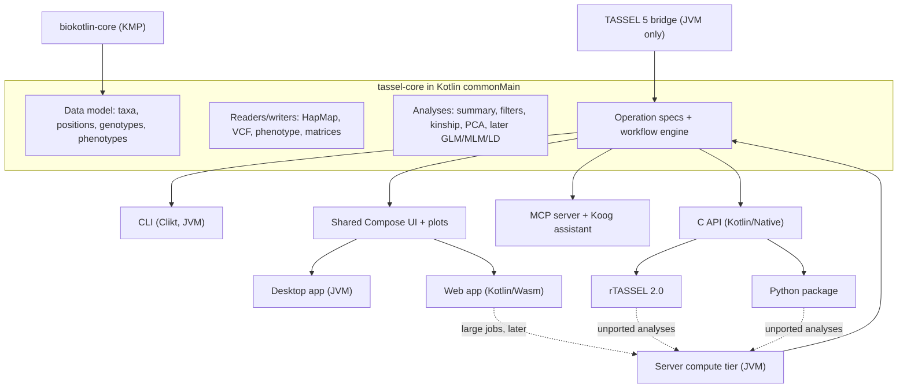
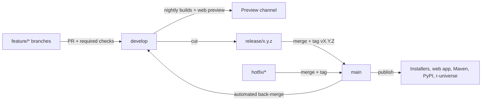

# TASSEL 6: Kotlin Multiplatform Roadmap and 1-Week Proof of Concept

## Decisions captured (from the two question rounds)

- **One shared core.** Pure Kotlin in `commonMain` with no JVM-only dependencies, compiled to the JVM, Wasm, and Kotlin/Native. That is a hard requirement: the web build and the native R/Python bindings both depend on it.
- **Release targets:**
  - CLI
  - Desktop app (Compose Multiplatform on the JVM)
  - Web app (Compose Multiplatform on Kotlin/Wasm; in-browser compute for teaching-scale data, with a JVM server tier added later)
  - R and Python, through a Kotlin/Native C API
- **Legacy support.** Port the high-use analyses natively. Reach the long tail through a JVM-only TASSEL 5 bridge. R and Python hand unported analyses to a local TASSEL 6 JVM process.
- **CLI.** A new Clikt subcommand CLI, plus a translator for TASSEL 5 `run_pipeline.pl` syntax.
- **R package.** rTASSEL 2.0 keeps the rTASSEL 1.0 API on the native backend and lives in the monorepo under `bindings/r`. Python lives under `bindings/python`. Assumption: the `tassel-r` repo keeps rTASSEL 1.x on TASSEL 5 until 2.0 ships.
- **BioKotlin.** Carve out a multiplatform `biokotlin-core` module containing:
  - [`Position.kt`](/Users/bm646-admin/Projects/biokotlin/src/main/kotlin/biokotlin/genome/Position.kt)
  - [`SampleGamete.kt`](/Users/bm646-admin/Projects/biokotlin/src/main/kotlin/biokotlin/genome/SampleGamete.kt)
  - ranges
  - [`IUPACData.kt`](/Users/bm646-admin/Projects/biokotlin/src/main/kotlin/biokotlin/seq/IUPACData.kt)

  Full BioKotlin (htsjdk-backed I/O) is used on the JVM only.
- **Parity.** Strict golden tests against a pinned TASSEL 5 release.
- **Process and platform.** Full git flow, JDK 25, teaching-first public release, and out-of-core storage as the long-term design.
- **MCP.** A local stdio MCP server, an in-app Koog assistant, and a regenerated `tassel-cli` skill.
- **Pangenome.** Read PS4G, imputed VCF, and h.vcf files, and add a PS4G/haplotype viewer.
- **PoC conditions.** Built by one developer with AI agents, shown as a live demo, benchmarked on synthetic data.
- **Licensing.** TASSEL 5 and TASSEL 6 are both Apache 2.0, so ported code carries over with no licensing issues.
- **Why rewrite the core instead of compiling TASSEL 5 to Wasm.** The TeaVM experiment in `tassel_wasm` needed Wasm-specific forks of TASSEL builders and log4j stubs. That approach also offers no path to native R/Python bindings.

## Architecture



## Efficiency levers (how one developer plus agents can cover six targets)

1. **One core for every target.** Each algorithm exists once. The same `commonTest` golden suite runs on the JVM, Wasm (Node), and Native. That delivers the cross-tier numerical agreement that [`UI_ARCHITECTURE.md`](/Users/bm646-admin/Projects/tassel_6/docs/llm_notes/UI_ARCHITECTURE.md) calls for.
2. **Operation specs as the single source of truth.** This modernizes TASSEL 5's self-describing [`PluginParameter.java`](/Users/bm646-admin/Projects/tassel/src/main/java/net/maizegenetics/plugindef/PluginParameter.java). Each operation is declared once, and the following are generated from that declaration:
   - CLI subcommands
   - GUI parameter forms
   - MCP tool schemas
   - C API entries
   - docs and the agent skill
   - the TASSEL 5 legacy translator

    Sketch:

```kotlin
val FilterSites = operation<GenotypeTable, GenotypeTable>(
    id = "filter-sites",
    legacyPlugin = "FilterSiteBuilderPlugin",
) {
    val minMaf by double(default = 0.0, range = 0.0..0.5, legacy = "siteMinAlleleFreq", help = "Minimum minor allele frequency")
    val minCount by int(default = 0, legacy = "siteMinCount", help = "Minimum number of non-missing taxa")
    run { input, progress -> filterSites(input, minMaf(), minCount(), progress) }
}
```

3. **TASSEL 5 golden outputs as the porting oracle.** Once the goldens exist, each port is an independent, verifiable task. Port tasks can then run as parallel agent jobs in isolated worktrees, with "golden tests pass on all targets" as the acceptance criterion.
4. **Streaming-first analysis API.** Analyses consume genotypes in blocks of sites. Kinship and PCA accumulate over site blocks, and filters and summary stream. The PoC keeps data in memory, and the planned out-of-core store can replace it later without rewriting analyses.
5. **Legacy bridge instead of porting everything.** About 130 TASSEL 5 plugins can be reached through the bridge until each one is ported.
6. **Reuse existing lab assets:**
   - TASSEL 5 CI patterns: [`sync_main_to_develop.yml`](/Users/bm646-admin/Projects/tassel/.github/workflows/sync_main_to_develop.yml), [`nightly.yml`](/Users/bm646-admin/Projects/tassel/.github/workflows/nightly.yml), [`coverage.yml`](/Users/bm646-admin/Projects/tassel/.github/workflows/coverage.yml)
   - PHG v2 CLI conventions: [`Phg.kt`](/Users/bm646-admin/Projects/phg_v2/src/main/kotlin/net/maizegenetics/phgv2/cli/Phg.kt), [`CliktLogging.kt`](/Users/bm646-admin/Projects/phg_v2/src/main/kotlin/net/maizegenetics/phgv2/cli/CliktLogging.kt)
   - The Koog agent pattern in `sra_koog`: [`ChatAgent.kt`](/Users/bm646-admin/Projects/sra_koog/src/jvmMain/kotlin/net/maizegenetics/srakoog/server/ChatAgent.kt)
7. **Pluggable compute engine.** The UI calls an `Engine` interface. Only a local in-process engine exists in the PoC; a remote engine for the server tier can be added later without touching screens.

## Target repository layout (the PoC uses only the first three modules)

```
tassel-6/
  tassel-core/            commonMain: model, io, linalg, analysis, ops (split into submodules in Phase 1)
  tassel-cli/             JVM: Clikt CLI, legacy translator, later `tassel mcp` and `tassel serve`
  tassel-app/             Compose Multiplatform: shared UI + desktopMain + wasmJsMain entry points
  tassel-server/          Phase 3: Ktor compute tier
  legacy/tassel5-bridge/  Phase 3: JVM adapter over TASSEL 5 plugins
  bindings/capi/          Phase 4: Kotlin/Native shared library + C header
  bindings/r/             Phase 4: rTASSEL 2.0
  bindings/python/        Phase 4: Python package
  testdata/golden/        TASSEL 5 reference outputs + manifest (TASSEL version, parameters)
  docs/adr/  AGENTS.md  docs/porting-ledger.md
```

## Proof of concept (live demo in about a week, around Nov 5)

**Definition of done:**

- CI is green on pull requests into `develop`: tests on the JVM, Wasm, and Native.
- The CLI, desktop app, and web app each load the tutorial HapMap, summarize it, filter sites and taxa, and compute Centered IBS kinship and PCA.
- All three targets produce identical numbers that match TASSEL 5 goldens.

**Day 1: walking skeleton and guardrails**

- Create `develop`. Add GitHub rulesets on `main` and `develop`, a PR template, and a conventional-commit check.
- Add `AGENTS.md` with the porting rules:
  - no `java.*` imports in `commonMain`
  - every port needs a golden test
  - log the source class of each port in `docs/porting-ledger.md`
- Record today's decisions as ADRs in `docs/adr/`.
- Replace the single-module [`build.gradle.kts`](/Users/bm646-admin/Projects/tassel_6/build.gradle.kts) and [`settings.gradle.kts`](/Users/bm646-admin/Projects/tassel_6/settings.gradle.kts):
  - add `gradle/libs.versions.toml` and the three modules
  - move the toolchain from JDK 21 to JDK 25
  - give `tassel-core` the targets `jvm`, `wasmJs` (browser + Node), `macosArm64`, and `linuxX64`
- Get a "hello" running on the CLI, desktop, and browser on day 1 so toolchain problems surface early.
- Add `ci.yml` for pull requests to `develop` and `main`.
- Write `scripts/golden/generate.sh`. It runs the pinned TASSEL 5 `run_pipeline.pl` on [`mdp_genotype.hmp.txt`](/Users/bm646-admin/Projects/tassel/dataFiles/Tutorial/mdp_genotype.hmp.txt) and writes full-precision outputs.
  - Today's kinship test only checks to a tolerance of 8e-6 against a stored file in [`CenteredIBSTest.java`](/Users/bm646-admin/Projects/tassel/src/test/java/net/maizegenetics/analysis/distance/CenteredIBSTest.java), so the goldens should be regenerated at full precision.
  - Keep the R `prcomp` values in [`PrinCompTest.java`](/Users/bm646-admin/Projects/tassel/src/test/java/net/maizegenetics/stats/PCA/PrinCompTest.java) as a second oracle.
- Confirm that kotlinx-io can read test files on the JVM, Native, and Node-hosted Wasm. If not, fall back to generated test resources.

**Day 2: data model, I/O, summary, filters**

- Port the genotype encoding from [`NucleotideAlignmentConstants.java`](/Users/bm646-admin/Projects/tassel/src/main/java/net/maizegenetics/dna/snp/NucleotideAlignmentConstants.java). Use the storage layout of [`SuperByteMatrix.java`](/Users/bm646-admin/Projects/tassel/src/main/java/net/maizegenetics/util/SuperByteMatrix.java) and [`ByteGenotypeCallTable.java`](/Users/bm646-admin/Projects/tassel/src/main/java/net/maizegenetics/dna/snp/genotypecall/ByteGenotypeCallTable.java).
- Build a site-major genotype table that can be read in blocks of sites, plus `TaxaList`, `PositionList`, and allele statistics from [`AlleleFreqCache.java`](/Users/bm646-admin/Projects/tassel/src/main/java/net/maizegenetics/dna/snp/genotypecall/AlleleFreqCache.java).
- Write a HapMap reader and writer, based on [`BuilderFromHapMap.java`](/Users/bm646-admin/Projects/tassel/src/main/java/net/maizegenetics/dna/snp/io/BuilderFromHapMap.java), over kotlinx-io `Source`/`Sink`. Add a minimal VCF reader for the genotype (GT) field. In the PoC, gzip works on the JVM only.
- Port genotype summary from [`GenotypeSummaryPlugin.java`](/Users/bm646-admin/Projects/tassel/src/main/java/net/maizegenetics/analysis/data/GenotypeSummaryPlugin.java).
- Port a parameter subset of the site and taxa filters from [`FilterSiteBuilderPlugin.java`](/Users/bm646-admin/Projects/tassel/src/main/java/net/maizegenetics/analysis/filter/FilterSiteBuilderPlugin.java) and [`FilterTaxaBuilderPlugin.java`](/Users/bm646-admin/Projects/tassel/src/main/java/net/maizegenetics/analysis/filter/FilterTaxaBuilderPlugin.java):
  - sites: minimum count, minor allele frequency (MAF) range, heterozygosity range, region
  - taxa: minimum non-missing fraction, heterozygosity
- Add golden tests for summary and filters on all targets.
- Time-boxed to 2 hours: try `biokotlin-core` as a new subproject in BioKotlin, wired in with `includeBuild("../biokotlin")`. If that doesn't work in time, use local types shaped to move there in Phase 1.

**Day 3: linear algebra, kinship, PCA, operation specs**

- Write a pure-Kotlin dense symmetric eigensolver, porting either JAMA (public domain) or EJML algorithms (Apache 2.0).
- Port Centered IBS kinship from [`EndelmanDistanceMatrix.java`](/Users/bm646-admin/Projects/tassel/src/main/java/net/maizegenetics/analysis/distance/EndelmanDistanceMatrix.java), as dispatched by [`KinshipPlugin.java`](/Users/bm646-admin/Projects/tassel/src/main/java/net/maizegenetics/analysis/distance/KinshipPlugin.java). Write it as an accumulation over site blocks.
- Implement PCA to match the outputs of [`PrinComp.java`](/Users/bm646-admin/Projects/tassel/src/main/java/net/maizegenetics/stats/PCA/PrinComp.java) and [`PrincipalComponentsPlugin.java`](/Users/bm646-admin/Projects/tassel/src/main/java/net/maizegenetics/analysis/data/PrincipalComponentsPlugin.java): PC scores, eigenvalues, and eigenvectors.
  - Compute it from the taxa-by-taxa Gram matrix, which needs far less memory when there are many more sites than taxa.
  - Normalize eigenvector signs deterministically so results are comparable.
- Build the operation registry with `summary`, `filter-sites`, `filter-taxa`, `kinship`, and `pca`, each with typed parameters and TASSEL 5 parameter names.
- Add golden tests for kinship and PCA (PCA compared up to sign).

**Day 4: CLI and shared UI**

- Build the `tassel` CLI. Generate its subcommands from the operation specs and follow the PHG v2 conventions:
  - Mordant help formatter
  - `--version`
  - logging of each command invocation
- Write outputs in TASSEL-compatible formats (HapMap, square kinship matrix, PCA tables) so TASSEL 5 can read them back.
- Build the Compose app:
  - a dataset tree, like TASSEL's Data panel
  - a canvas-virtualized genotype grid with nucleotide colors
  - summary tables
  - parameter forms generated from the specs
  - a kinship heatmap
  - a PCA scatter plot with selectable PCs and hover labels
  - light and dark themes
- File loading:
  - desktop: a native file dialog
  - web: a browser file input (for example, the FileKit library), plus a bundled "Load tutorial dataset" button

**Day 5: web polish, benchmarks, demo prep**

- Run the same UI in the browser. Long computations yield in chunks and show progress so the page stays responsive; there are no web workers in the PoC.
- Add a synthetic data generator, `tassel dev simulate --taxa 1000 --sites 100000` (and 1M sites).
- Write `scripts/bench/` to time TASSEL 5 (fixed `-Xmx`) against the TASSEL 6 JVM build on filter, kinship, and PCA. Publish the results in `docs/poc/benchmarks.md`.
- Write the demo script and README.
- Run git flow end to end: feature PRs into `develop`, then `release/6.0.0-poc.1`, a tag on `main`, and a merge back into `develop`.

**Demo flow (about 15 minutes, live):**

1. Architecture and repo: one core, three targets, CI.
2. CLI pipeline, with a parity report against TASSEL 5.
3. Desktop workflow from loading through the PCA plot.
4. The same workflow in the browser, computing locally in Wasm and giving the same numbers.
5. Benchmarks, roadmap, and moonshots.

**Cut list (drop in this order if behind):**

1. VCF reader
2. 1M-site benchmark
3. Web file upload (keep the bundled dataset)
4. Genotype grid polish

Never cut the golden parity tests, the CLI, or the desktop and web apps showing the same kinship and PCA results.

**Stretch goals (in order):**

1. `tassel legacy translate -- <run_pipeline args>` for the five ported operations.
2. `tassel mcp` over stdio, exposing the five operations to Cursor or Claude.
3. A Kotlin/Native shared-library spike with a short Python `ctypes` kinship call.
4. A JVM fast path for kinship (blocked matrix multiply plus coroutines), with a parity test.

## Roadmap after the PoC

**Phase 1: foundation (2-3 weeks)**

- Split `tassel-core` into model, io, linalg, stats, analysis, and ops modules. Add Gradle convention plugins in `build-logic`.
- Automate git flow fully:
  - a release-branch workflow
  - changelogs generated with `git-cliff`
  - an automated merge from `main` back to `develop`, modeled on TASSEL 5's sync workflow
  - nightly and preview builds from `develop`
- Run spikes, each ending with a go/no-go note:
  - compute in Wasm web workers
  - the Kotlin/Native C API, with Python and R hello-world calls
  - publishing `biokotlin-core` as an additive module (no breaking changes for PHG v2 or GRITS)
  - an ADR on the out-of-core storage format (candidates: VCF Zarr, PLINK 2 pgen, a custom chunked format)
- Fill in the porting ledger for all of about 130 TASSEL 5 plugins, marking each as port, bridge, or retire.

**Phase 2: teaching MVP, web first (6-10 weeks), released as `6.0.0-alpha`**

- Phenotypes (TASSEL `<Phenotype>`, `<Trait>`, and `<Covariate>` formats), intersect and union joins, and F, t, and chi-square distributions.
- GLM, MLM (EMMA/P3D with compression), LD with a heatmap, Manhattan and QQ plots, and NJ trees. Each gets parity tests with a tolerance policy set per analysis.
- Teaching features:
  - bundled tutorial datasets
  - a guided tutorial mode
  - results export
  - a "show command" view that records GUI actions as a workflow
- Hosting: GitHub Pages (stable builds from `main`, previews from `develop`), with browser tests for WasmGC support in Chrome, Firefox, and Safari.

**Phase 3: research tier (about 3 months, overlapping Phase 4)**

- An out-of-core chunked genotype store with streaming analyses.
- JVM acceleration: OpenBLAS/LAPACK called through JDK 25's Foreign Function & Memory (FFM) API, plus bit-packed kinship and LD kernels.
- JVM I/O through full BioKotlin/htsjdk: bgzip- and tabix-indexed VCF.
- The TASSEL 5 bridge:
  - Load a pinned TASSEL 5 jar in an isolated classloader. This avoids version clashes between TASSEL 5's htsjdk 2.x and Guava 22 and BioKotlin's htsjdk 4.x and Guava 33.
  - Expose TASSEL 5 plugins as TASSEL 6 operations automatically by reading their parameter metadata.
  - Build a full legacy translator that turns TASSEL 5 forks and combines into a workflow graph, following [`TasselPipeline.java`](/Users/bm646-admin/Projects/tassel/src/main/java/net/maizegenetics/pipeline/TasselPipeline.java).
- Also in this phase:
  - `tassel run workflow.yaml`
  - a Ktor server tier and a compute router for the web app
  - desktop installers
  - publishing the core to Maven Central

**Phase 4: R and Python (about 2 months)**

- `bindings/capi`: a small, versioned C ABI (handles, typed buffers, error codes) driven by the operation specs.
- rTASSEL 2.0: the rTASSEL 1.0 API (`TasselGenotype`, bracket and dplyr filtering, plots) on top of `.Call`. Distribute through r-universe and GitHub with prebuilt libraries, as rTASSEL is distributed today.
- Python: cffi with NumPy and pandas, wheels built with cibuildwheel, published to PyPI.
- Unported analyses are handed to a local `tassel serve` JVM process.
- R and Python parity tests reuse `testdata/golden`.

**Phase 5: agentic support (starts once the operation registry exists)**

- `tassel mcp`: a local stdio MCP server built on the Kotlin MCP SDK. Tools are generated from the specs, datasets and results are exposed as resources, and common workflows are offered as prompts.
- Regenerate the `[tassel-cli` skill](/Users/bm646-admin/Projects/tassel_cli_skill/SKILL.md) from the specs.
- An in-app Koog assistant that reuses the same tool definitions. It ships on desktop first; on the web it goes through the server tier.

**Phase 6: pangenome complements**

- A PS4G v2 reader in the core, ported from GRITS [`ps4g.rs`](/Users/bm646-admin/Projects/grits/crates/parser-core/src/ps4g.rs) and its [spec](/Users/bm646-admin/Projects/grits/docs/cli.md).
- A Compose PS4G heatmap and founder-mosaic viewer, borrowing ideas from [`PS4GExplorer.tsx`](/Users/bm646-admin/Projects/grits/src/components/PS4GExplorer.tsx).
- Reading imputed VCF from PHG `bed-to-vcf` and PHG h.vcf files, and running GWAS on the imputed genotypes.

## Git flow and CI/CD



- **Versioning.** SemVer: `6.0.0-poc.1`, then `6.0.0-alpha.N`, with nightly builds tagged `6.0.0-dev.YYYYMMDD`.
- **Pull request checks:**
  - tests on the JVM, Wasm (Node), and Native (Linux and macOS runners)
  - golden parity tests
  - ktlint/detekt
  - Kover coverage
  - an ABI check on the core's public API
- **Delivery:**
  - From `develop`: nightly CLI builds and a web preview.
  - From tags on `main`: CLI distributions, desktop installers for each OS, and the web site; later also Maven Central, PyPI, r-universe, and a server Docker image.
- **Drift detection.** A scheduled job regenerates the goldens from the pinned TASSEL 5 to catch drift.

## Moonshot goals

- **Same numbers everywhere.** One golden suite passes on the JVM, browser Wasm, Native, R, and Python, and is published as a public conformance suite.
- **Reproducible by default.** Every GUI action becomes a workflow that can be exported to CLI, R, Python, or MCP form, replayed on any target, and archived with a DOI.
- **Biobank scale on a laptop.** Out-of-core storage plus streaming GLM/MLM (REGENIE-style approximations) for 100K samples by 10M variants in bounded memory.
- **Browser supercomputing:**
  - WebGPU kernels for kinship, PCA, and GLM
  - streaming remote chunked data with HTTP range requests, so nothing has to be uploaded
  - an offline progressive web app for classrooms
- **Spec-to-everything generator.** CLI, GUI, MCP tools, R and Python functions, docs, and the skill all generated, with no hand-written bindings.
- **AI porting factory.** Agents port the remaining TASSEL 5 plugins against the goldens, tracked on a public porting ledger, until the legacy bridge can be retired.
- **Conversational GWAS.** An assistant plans and runs analyses through MCP, explains QC results such as genomic inflation, and narrates candidate genes using BioKotlin GFF annotations and `candidate_gene_storytelling_agent`.
- **Reads to GWAS in one app.** ropebwt3 `refmap`, then GRITS imputation, the PS4G viewer, and haplotype-aware GWAS on founder mosaics.
- **Universal plugins through the Wasm Component Model.** Third-party analyses written once in Kotlin, Rust, or C run in the browser, desktop, CLI, R, and Python.
- **Linked visual genomics.** Brushing a PCA plot selects taxa across the Manhattan, LD, genotype grid, and haplotype views. Figures export as publication-quality SVG.
- **Single-binary native CLI.** A Kotlin/Native build for HPC with instant startup, packaged for bioconda.

## Risks and mitigations

- **Browser readiness.** Compose for Web is still maturing, and Kotlin/Wasm needs WasmGC, which lab machines with older Safari versions may lack. Mitigation: get the hello app running on Day 1, add a browser test matrix in Phase 2, and evaluate a JS fallback.
- **Single-threaded Wasm.** Mitigation: chunked computation with yields in the PoC, web workers in Phase 1-2, and the server tier for big jobs.
- **Kotlin/Native numeric performance and C ABI ergonomics.** Mitigation: the Phase 1 spike, plus calling BLAS through cinterop on Native.
- **Parity for iterative estimators such as MLM REML.** Mitigation: a tolerance policy for each analysis and documented deviations.
- **Legacy bridge dependency clashes.** Mitigation: an isolated classloader, with a subprocess as the fallback.
- **BioKotlin changes affecting PHG v2 and GRITS.** Mitigation: `biokotlin-core` is additive only.
- **Solo bandwidth.** Mitigation: the strict cut list, and agent tasks gated by golden tests.

## Decisions deferred to ADRs (open questions for later)

- Out-of-core storage format (VCF Zarr, PLINK 2 pgen, or custom).
- Desktop installers and auto-update (jDeploy as in TASSEL 5, Conveyor, or Compose native distributions).
- Web hosting domain, plus custom headers for future Wasm threads.
- LLM provider and data-privacy policy for the in-app assistant.
- Naming: the `tassel` CLI command, the Python package name, and Maven coordinates.
- Gzip handling per platform.