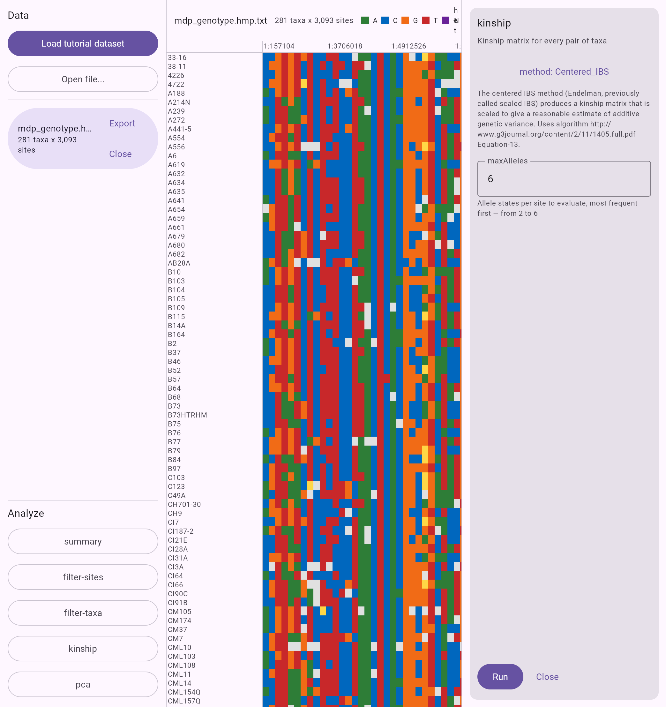

# TASSEL 6 PoC benchmarks

How the TASSEL 6 proof of concept performs against TASSEL 5 on the same inputs and the same
analyses. Reproduce every JVM number in this document with:

```bash
scripts/bench/run-benchmarks.sh --runs 3
```

The script downloads the pinned TASSEL 5 standalone release, builds the TASSEL 6 CLI, generates the
synthetic inputs with `tassel dev simulate`, and prints the table below. See
[`scripts/bench/run-benchmarks.sh`](../../scripts/bench/run-benchmarks.sh) for the exact pipelines
and subcommands each row runs.

## What was measured

| | |
|---|---|
| Host | Apple M2 Max, 12 cores, 64 GiB, macOS 27.0.1 (26A434) |
| JDK | Eclipse Temurin 25.0.4.1+1, `-Xmx8g` for both tools |
| TASSEL 5 | v5.2.98 standalone, `-maxThreads 4` |
| TASSEL 6 | 6.0.0-dev at commit `68e0325` |
| Runs | Median of 3, after one warm-up run that is discarded |

Both tools get the same heap so neither wins on memory configuration alone. TASSEL 5 is pinned to
four threads for the same reason `scripts/generate-goldens.sh` pins it: it fixes Centered IBS at
1,000-site blocks, so results do not depend on the host's core count. **TASSEL 6 is single threaded
today**, which matters for one row below and is called out there.

Datasets are the tutorial HapMap (281 taxa x 3,093 sites) and a synthetic 1,000 taxa x 100,000
sites HapMap from `tassel dev simulate --seed 0`. The 1,000 x 1,000,000 set the roadmap also asks
for is behind `--million`; it was not run for this document because TASSEL 5's PCA already needs
7.7 GiB at 100,000 sites and does not fit the 8 GiB budget ten times over.

## Results

Ratio above 1 means TASSEL 6 is faster. Peak is the peak resident set of the whole process.

| Dataset | Analysis | TASSEL 5 time | TASSEL 6 time | Ratio | TASSEL 5 peak | TASSEL 6 peak |
|---------|----------|--------------:|--------------:|------:|--------------:|--------------:|
| none | startup only | 5.34 s | 0.18 s | 29.67x | 105 MiB | 83 MiB |
| tutorial | load | 5.48 s | 0.25 s | 21.92x | 150 MiB | 105 MiB |
| tutorial | summary | 5.54 s | 0.30 s | 18.47x | 159 MiB | 130 MiB |
| tutorial | filter-sites | 5.52 s | 0.26 s | 21.23x | 154 MiB | 109 MiB |
| tutorial | filter-taxa | 5.53 s | 0.29 s | 19.07x | 153 MiB | 109 MiB |
| tutorial | kinship | 5.50 s | 0.33 s | 16.67x | 156 MiB | 125 MiB |
| tutorial | pca | 6.19 s | 0.52 s | 11.90x | 235 MiB | 123 MiB |
| synthetic-100k | load | 7.84 s | 1.72 s | 4.56x | 708 MiB | 820 MiB |
| synthetic-100k | summary | 8.32 s | 2.16 s | 3.85x | 864 MiB | 914 MiB |
| synthetic-100k | filter-sites | 8.00 s | 2.13 s | 3.76x | 721 MiB | 913 MiB |
| synthetic-100k | filter-taxa | 7.92 s | 2.10 s | 3.77x | 708 MiB | 906 MiB |
| synthetic-100k | kinship | 8.13 s | 19.51 s | 0.42x | 713 MiB | 811 MiB |
| synthetic-100k | pca | 274.14 s | 57.13 s | 4.80x | 7,721 MiB | 887 MiB |

### Read the tutorial rows carefully

The "startup only" row runs TASSEL 5's pipeline with no plugin and TASSEL 6 with `--version`.
Neither does any work. TASSEL 5 still takes 5.34 s, so **every tutorial row is about 97% startup**,
and the 12x-to-22x ratios there say almost nothing about the analyses. Subtracting the startup row
gives the actual work:

| Analysis | TASSEL 5 work | TASSEL 6 work |
|----------|--------------:|--------------:|
| tutorial load | 0.14 s | 0.07 s |
| tutorial summary | 0.20 s | 0.12 s |
| tutorial kinship | 0.16 s | 0.15 s |
| tutorial pca | 0.85 s | 0.34 s |

On tutorial-sized data the two tools do comparable work and TASSEL 5's cost is the JVM plus its
plugin registry. That startup cost is not a rounding error for users: it is the difference between
a tool that feels interactive and one that does not, and it is why the 100,000-site rows are the
honest comparison of the analyses themselves.

### Parity

For `load`, `filter-sites`, `filter-taxa`, and `kinship` on the tutorial data, the two tools' output
files are **byte-for-byte identical**, including the `##Centered_IBS.SumPk=918.7297856754799` header
on the kinship matrix. This is the same property the golden tests enforce (see
[ADR-0009](../adr/0009-strict-golden-parity.md)); the benchmark run is an independent check of it
at the command-line level.

## Known limits

### Centered IBS at scale is slower, and most of that is threading

The one row where TASSEL 6 loses is `synthetic-100k kinship`: 19.51 s against 8.13 s. Breaking it
down, with startup subtracted and TASSEL 5 re-measured at one thread:

| Configuration | Kinship work on 1000 x 100K |
|---------------|----------------------------:|
| TASSEL 5, 4 threads | 2.8 s |
| TASSEL 5, 1 thread | 9.1 s |
| TASSEL 6, 1 thread | 19.3 s |

TASSEL 5's `EndelmanDistanceMatrix` runs a parallel `Stream` over a site spliterator, which buys it
3.2x here. The remaining 2.1x is single-threaded throughput: TASSEL 5 accumulates over packed
two-bit allele-presence words, while the ported `centeredIbs` walks sites through the site-block
API. Neither gap is a correctness problem, and the tutorial-sized row shows the ported kernel is
competitive when the parallel stream has too little work to help.

Parallelism is deliberately absent from the PoC: `commonMain` has no threads on wasm, so adding
them means a platform-specific execution strategy, which is Phase 1 work rather than something to
improvise here.

### The eigensolver is the PoC's slowest primitive

Measured separately in #39 on the JVM after warm-up, over five runs, for the pure-Kotlin
`SymmetricEigenDecomposition`:

| Matrix | Time | Max residual \|Av - lambda v\| |
|--------|-----:|-------------------------------:|
| 1000 x 1000 | 1,277 ms minimum, 1,518 ms median | 1.4e-13 |
| 281 x 281 | 29 ms | 9.2e-14 |

PCA only ever decomposes a taxa-sized matrix, so 281 x 281 is the size the tutorial actually hits
and 1000 x 1000 is the size the synthetic set hits. Even at 1000 x 1000 the decomposition is under
3% of the 57 s PCA run, which is why the maintainer accepted these figures for the PoC. A LAPACK
`dsyevd` fast path is out of scope. The accuracy is what matters more: this is one pure-Kotlin
solver producing the same answer on all four targets, with no native dependency.

### Memory on the synthetic set

TASSEL 6 holds 820-914 MiB where TASSEL 5 holds 708-864 MiB for the three streaming analyses, so
TASSEL 6 is slightly heavier there. The reverse is true where it counts: TASSEL 5's PCA peaks at
7.7 GiB of the 8 GiB heap against TASSEL 6's 887 MiB, because TASSEL 5 materializes intermediate
matrices that the site-block API ([ADR-0012](../adr/0012-streaming-genotype-access.md)) lets
TASSEL 6 stream.

## Cost of the responsive-UI change

ADR-0019, proposed in [#56](https://github.com/maize-genetics/tassel-6/pull/56), makes
`ProgressReporter.report` a suspending function so that long-running core work yields to the event
loop, which is what keeps the browser drawing. Yielding is not free, so it was measured on the JVM
before and after:

| Path | Before | After |
|------|-------:|------:|
| Tutorial HapMap read | 22.1 ms | 22.7 ms |
| `centeredIbs` on the tutorial data | 58.6 ms | 59.8 ms |

Both are inside the run-to-run noise. The engine path, which performs 31 real yields on this input,
also lands at 59.8 ms, so the yields themselves cost roughly 0.6 ms in total.

The table above was measured on `develop` at `68e0325`, which does **not** include the ADR-0019
change ([#56](https://github.com/maize-genetics/tassel-6/pull/56) and
[#57](https://github.com/maize-genetics/tassel-6/pull/57) were open at the time). Given deltas this
small relative to the reported times, re-running after those merge should not move any row.

## The browser

The same `commonMain` code compiled to WebAssembly, on the tutorial data. Measured against the
production bundle (`./gradlew :tassel-app:wasmJsBrowserDistribution`) built from the ADR-0019
branch, served over `http://localhost`, in Chrome on the same Mac, with the tab in the foreground.

Wall time is from the click to the result appearing. **Longest frame gap** is the longest interval
between two `requestAnimationFrame` callbacks during that window, which is the number that decides
whether the page feels alive: this display refreshes every 8 ms, and anything past about 100 ms
reads as a freeze. Each step was run twice on a freshly loaded page; the two runs agreed to within
6 ms, so one set is reported.

| Step | Wall time | Longest frame gap | Frame gaps over 50 ms |
|------|----------:|------------------:|----------------------:|
| Load tutorial dataset | 160 ms | 33 ms | 0 |
| summary | 162 ms | 33 ms | 0 |
| kinship | 905 ms | 583 ms | 2 |
| pca | 1,216 ms | 1,083 ms | 1 |

Reading is now smooth, which is what ADR-0019 set out to fix: the HapMap reader reports every 256
sites, and the engine yields at every report, so a 160 ms parse costs at most a dropped frame or two
instead of locking the tab.

**The analyses still block, and this is a known limit, not a fixed problem.** `centeredIbs` reports
progress once per 1,000-site block, which is four reports for the tutorial's 3,093 sites, and the
eigensolver inside PCA reports nothing at all. A traced kinship run spends its 905 ms in two
uninterrupted stretches of roughly 533 ms and 307 ms rather than in four short ones. Reporting more
often inside these kernels does not change any result, because the block size and not the reporting
interval is what fixes the summation order that golden parity depends on, but it is a change to the
kernels and so is out of scope for the benchmarks task. It should be its own issue.

For scale, the same two analyses on the same data through the JVM CLI take 0.15 s and 0.34 s of
work, so WebAssembly is roughly 3x to 6x slower here. That is the expected cost of the target, not
a regression.



## What is not here

- **1,000 x 1,000,000 sites.** Behind `--million`. TASSEL 5's PCA will not fit in a reasonable heap
  at that size, so the row would compare TASSEL 6 against a failure.
- **Native targets.** `linuxX64` and `macosArm64` run the same `commonMain` code and the same
  golden tests, but there is no native CLI yet to time (Phase 1).
- **Multi-threaded TASSEL 6.** See the Centered IBS limit above.
