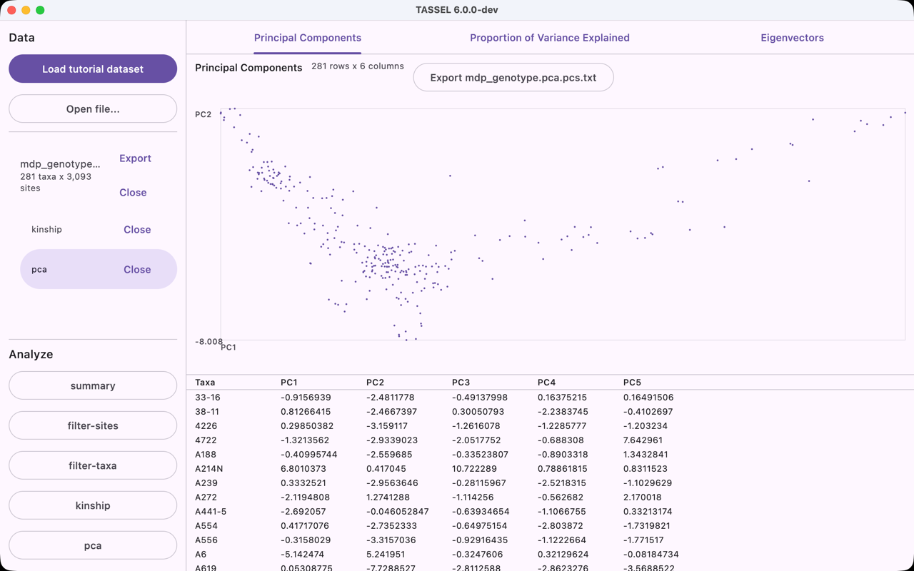

# TASSEL 6 proof-of-concept demo

A live walkthrough in about 15 minutes: one pure-Kotlin core, compiled to the JVM, WebAssembly, and
native, producing numbers that match TASSEL 5 exactly.

The five segments below follow the roadmap's demo flow. Timings are targets, not a script to read
aloud. Every command here was run end to end before being written down; the outputs quoted are real.

## Before the demo

Do all of this at least an hour ahead. Nothing here should happen while anyone is watching.

```bash
# 1. Build the CLI once, so no Gradle output appears during the demo.
./gradlew :tassel-cli:installDist

# 2. Put the CLI on PATH for the session, and give it a JDK 25.
export JAVA_HOME=$(./gradlew -q javaToolchains | awk '/JDK 25/ {f=1} f && /Location:/ {print $3; exit}')
export PATH="$PWD/tassel-cli/build/install/tassel/bin:$PATH"
tassel --version          # expect: tassel version 6.0.0-poc.1

# 3. Warm the desktop and web builds so neither compiles on stage.
./gradlew :tassel-app:wasmJsBrowserDistribution
./gradlew :tassel-app:run     # let it open, then quit it

# 4. Work in a scratch directory, not the repo.
mkdir -p /tmp/tassel-demo && cd /tmp/tassel-demo
export TUTORIAL="$OLDPWD/testdata/tutorial/mdp_genotype.hmp.txt"
export GOLDEN="$OLDPWD/testdata/golden"
```

Have open, and nothing else: a terminal with a large font, a browser tab on the web app, the GitHub
Actions page for the latest green run on `develop`, and
[`docs/poc/benchmarks.md`](benchmarks.md).

## 1. Architecture and repository (about 2 minutes)

The claim to make first, because everything else is evidence for it: **there is one implementation
of every analysis, and it runs on four targets.**

Show `tassel-core/src/commonMain/` and point out that the kinship, PCA, summary, and filter code
lives there once. Then show `tassel-core/build.gradle.kts` and the four targets: `jvm`, `wasmJs`,
`macosArm64`, `linuxX64`. There is no per-platform copy of an analysis; the only `expect`/`actual`
code is for file access.

Show the latest green CI run on `develop`. The checks that matter are `jvmTest`, `wasmJsTest`, and
`linuxX64Test`: the same tests, including the golden parity tests, on three runtimes.

Say the constraint out loud, because it is what makes the browser segment possible:
[`AGENTS.md`](../../AGENTS.md) forbids `java.*`, htsjdk, and every other JVM-only dependency in
`commonMain`, and CI enforces it.

## 2. The CLI, and parity with TASSEL 5 (about 4 minutes)

```bash
tassel --help
```

Every analysis subcommand and every one of its options is generated from an operation spec, so the
CLI, the UI forms, and the future R and Python bindings cannot drift apart.

Run the pipeline on the tutorial data, 281 taxa by 3,093 sites:

```bash
tassel filter-sites --input "$TUTORIAL" --min-maf 0.05 --output filtered
tassel kinship      --input filtered.hmp.txt --output kinship
tassel pca          --input filtered.hmp.txt --output pca
```

Each finishes in well under a second and prints a progress line and the files it wrote.

Now the part worth pausing on. Run the same analyses on the unfiltered tutorial file and compare
them to TASSEL 5's own output, byte for byte:

```bash
tassel --quiet kinship      --input "$TUTORIAL" --output parity
tassel --quiet summary      --input "$TUTORIAL" --output parity
tassel --quiet pca          --input "$TUTORIAL" --output parity
tassel --quiet filter-sites --input "$TUTORIAL" --min-maf 0.05 --max-maf 0.4 --output parity-maf
tassel --quiet filter-taxa  --input "$TUTORIAL" --min-not-missing 0.95 --output parity-taxa

diff parity.txt            "$GOLDEN/kinship/centered_ibs.txt"            && echo "kinship: identical"
diff parity.overview.txt   "$GOLDEN/summary/overview.txt"                && echo "overview: identical"
diff parity.sites.txt      "$GOLDEN/summary/sites.txt"                   && echo "sites: identical"
diff parity.taxa.txt       "$GOLDEN/summary/taxa.txt"                    && echo "taxa: identical"
diff parity-maf.hmp.txt    "$GOLDEN/filter-sites/maf-0.05-0.4.hmp.txt"   && echo "filter-sites: identical"
diff parity-taxa.hmp.txt   "$GOLDEN/filter-taxa/min-not-missing-0.95.hmp.txt" && echo "filter-taxa: identical"
```

All six print `identical` and `diff` says nothing. These are not tolerances. The files under
`testdata/golden/` are TASSEL 5 v5.2.98's own output, generated by
[`scripts/generate-goldens.sh`](../../scripts/generate-goldens.sh) and never edited
([ADR-0009](../adr/0009-strict-golden-parity.md)), down to the
`##Centered_IBS.SumPk=918.7297856754799` header on the kinship matrix.

PCA is the one honest exception, and it is worth explaining rather than skipping:

```bash
head -4 parity.eigenvalues.txt
head -4 "$GOLDEN/pca/eigenvalues.txt"
```

The leading eigenvalues agree exactly. TASSEL 5 gets its eigenvalues from an SVD that does not sort
them, so the mapping from principal-component index to eigenvalue differs between the two tools even
though the set of eigenvalues is the same; 280 of the 281 values match to the digit, and the one
that does not is the degenerate last component, which is zero in both (`3.5e-15` against `9.3e-30`).
The golden test compares those rows without regard to order, and eigenvectors up to sign, for
exactly this reason.

## 3. The desktop app (about 3 minutes)

```bash
./gradlew :tassel-app:run
```

Walk the same workflow a TASSEL 5 user knows:

1. **Load tutorial dataset.** The data panel shows `mdp_genotype.hmp.txt`, 281 taxa x 3,093 sites,
   and the genotype grid draws with nucleotide colors. Scroll it: the grid is canvas-virtualized, so
   it stays smooth over the whole table.
2. **kinship.** Picking an analysis opens a parameter form. Point out that nobody wrote this form:
   it is generated from the same operation spec that generated the CLI flags, down to the help text
   and the 2-to-6 bound on `maxAlleles`.
3. **Run.** The result is a heatmap plus the matrix itself. These are the same numbers the CLI just
   wrote.
4. **pca**, then **Run**. Three tabs: the PC1-against-PC2 scatter plot with the scores beneath it,
   the proportion of variance explained, and the eigenvectors.
5. **Export.** Writes a file TASSEL 5 can read back.

Compare a value against the terminal while both are on screen. The app loaded the unfiltered
tutorial file, so the row to match is in `parity.txt` from segment 2: taxon `33-16` against itself
is `1.7978103` in both, because it is the same `centeredIbs` running in both.



## 4. The same app in the browser (about 4 minutes)

This is the segment to spend time on, because it is the one that is hard to believe.

Open the web app. It is the same Compose code and the same `tassel-core`, compiled to WebAssembly.
Say up front that there is no server: once the page has loaded, no data leaves the machine. That
usually settles the first question anyone asks about analyzing genotypes in a browser.

Repeat the workflow exactly as on the desktop: load the tutorial dataset, run kinship, run PCA. Put
the desktop window beside the browser and compare a few kinship values and the PCA plot. They agree,
because it is one implementation.

Two things to say honestly while it runs:

- **Loading is smooth.** The reader reports progress every 256 sites and the engine yields at every
  report, so the page keeps drawing through the parse
  (ADR-0019, [#56](https://github.com/maize-genetics/tassel-6/pull/56)). The tutorial file loads
  in about 160 ms with no dropped frame longer than 33 ms.
- **Kinship reports during the matrix, PCA reports during each pass, and the eigensolver does not.**
  Centered IBS reports about every 100 sites (31 times on the tutorial file). Each PCA pass reports
  every 256 sites. The decomposition between the Gram pass and the eigenvector pass still has no
  report; on a warm Wasm run that stretch is about 140 ms. The frame gaps in
  [`docs/poc/benchmarks.md`](benchmarks.md) were measured before the running banner yielded after
  each report, so say that they are the previous measurement, not a number to quote as current.

If someone asks about large files in the browser: the PoC has no web workers, so this is the single
UI thread doing real work. That is a Phase 1 item, not a gap we are pretending does not exist.

## 5. Benchmarks, roadmap, and what is next (about 2 minutes)

Open [`docs/poc/benchmarks.md`](benchmarks.md) and make three points, in this order.

1. **Startup.** TASSEL 5 needs 5.3 seconds to start its pipeline before it reads anything; TASSEL 6
   starts in 0.18 s. On tutorial-sized data that is the entire difference, and for anyone who runs
   TASSEL from a script it is the difference that matters most.
2. **PCA at scale.** On 1,000 taxa by 100,000 sites, TASSEL 5 takes 274 s and peaks at 7.7 GiB of an
   8 GiB heap. TASSEL 6 takes 57 s and peaks at 887 MiB, because analyses stream site blocks instead
   of materializing matrices ([ADR-0012](../adr/0012-streaming-genotype-access.md)).
3. **Where TASSEL 6 loses.** Centered IBS on the same set takes 19.3 s against TASSEL 5's 2.8 s.
   TASSEL 5 runs it on four threads and over packed two-bit words; TASSEL 6 is single-threaded
   today. Show the breakdown table. Saying this before anyone finds it is worth more than the row
   costs.

Close on the roadmap: Phase 1 splits the core into modules and adds a parallel execution strategy,
Phase 4 adds the R and Python bindings over a C ABI
([ADR-0007](../adr/0007-native-bindings-r-python.md)), and the thing that makes all of it
tractable is the property demonstrated in segments 2 through 4: port an analysis once, get it
everywhere, and prove it against TASSEL 5's own output.

## If something breaks

- **The CLI cannot find a JDK 25.** `JAVA_HOME` is wrong or unset; the installed script needs 25,
  and a system Java 21 fails with `UnsupportedClassVersionError`. Re-run the `export JAVA_HOME` line
  from the prep section.
- **The desktop app will not start.** Fall back to the browser; it runs the same code. Do not debug
  Skiko on stage.
- **The browser tab is slow or stalls.** Reload the page. If a dataset is already loaded, the
  analyses block the UI thread for up to a second, which is expected and documented; wait rather
  than clicking again.
- **A `diff` in segment 2 prints output.** Stop and say so, then move on. A golden mismatch is a
  real finding, and pretending otherwise is worse than an awkward moment. The run is reproducible
  later.
